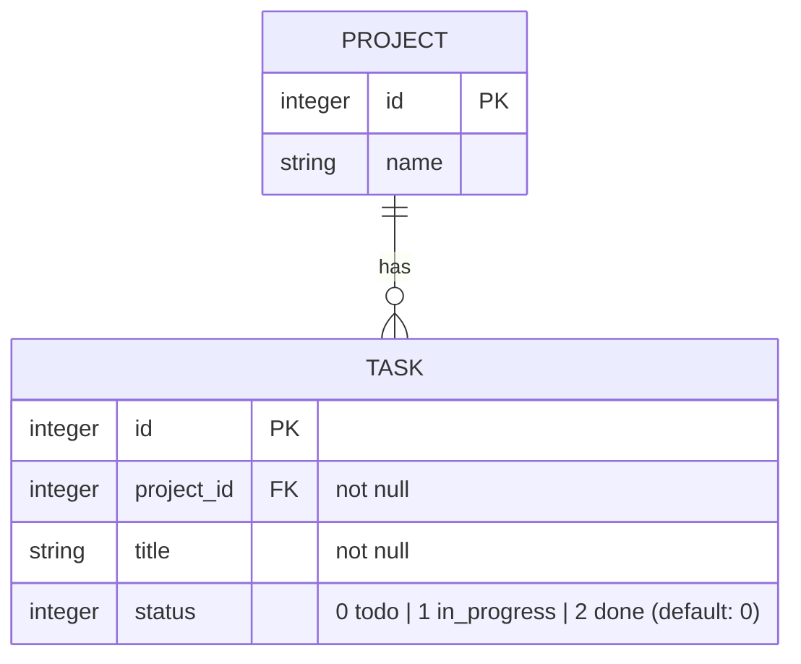

# Hotwire Bootcamp

## Table of Contents

1. [Prerequisites](#1-prerequisites)
2. [What is Hotwire?](#2-what-is-hotwire)
3. [SPA vs HTML over the wire](#3-spa-vs-html-over-the-wire)
4. [Environment Setup](#4-environment-setup)
5. [Project Structure](#5-project-structure)
6. [Turbo Drive](#6-turbo-drive)
7. [Turbo Frames](#7-turbo-frames)
8. [Turbo Streams](#8-turbo-streams)
9. [Broadcasting (Real-time)](#9-broadcasting-real-time)
10. [Page Refresh & Morphing](#10-page-refresh--morphing)
11. [Stimulus](#11-stimulus)
12. [Workshop: Task App](#12-workshop-task-app)
13. [Best Practices & Common Pitfalls](#13-best-practices--common-pitfalls)
14. [Resources](#14-resources)

## 1. Prerequisites

**ความรู้พื้นฐานที่จำเป็น:**

- พื้นฐาน Ruby และ Ruby on Rails (MVC, Routing, ActiveRecord)
- ความรู้ HTML/CSS
- พื้นฐาน JavaScript (ES modules, class, event)
- ติดตั้ง Docker Desktop (หรือ Docker Engine + Docker Compose)
- ติดตั้ง VS Code พร้อม Ruby LSP Extension

## 2. What is Hotwire?

**Hotwire (HTML Over The Wire)** คือแนวทางการสร้างเว็บแอปที่รู้สึกเร็วเหมือน SPA

- Server ส่ง **HTML** แทน **JSON**
- เขียน JavaScript น้อยลงมาก
- logic ส่วนใหญ่ยังอยู่ที่ฝั่ง Server

Hotwire ประกอบด้วย 3 ส่วนที่ทำงานร่วมกัน:

| ส่วนประกอบ          | ตอบคำถาม                          | ตัวอย่างงาน                                        |
| ------------------ | -------------------------------- | ------------------------------------------------ |
| **Turbo**          | HTML ใหม่จะมาแทนที่ตรงไหนของหน้า     | เปลี่ยนหน้า, submit form, อัปเดตบางส่วน, real-time    |
| **Stimulus**       | ต้องการ JS เล็ก ๆ ฝั่ง client ตรงไหน | toggle, dropdown, copy to clipboard, auto-submit |
| **Hotwire Native** | จะนำเว็บเดิมไปเป็นแอปมือถือยังไง        | แอป iOS / Android ที่ใช้หน้าเว็บจาก Server            |

**หลักการเลือกใช้:**

1. **Turbo:** เริ่มจากตัวนี้ก่อน (ไม่ต้องเขียน JS)
2. **Stimulus:** ใช้เมื่อต้องการ behavior ที่ไม่ต้องคุยกับ Server
3. **Hotwire Native:** ใช้เมื่อต้องการแอปมือถือจากเว็บเดิม

### Turbo

Turbo คือหัวใจของ Hotwire

- **หน้าที่:** ส่ง request แทน Browser แล้วนำ HTML ที่ Server ตอบกลับมาไปแทนที่ในหน้าเว็บ โดยไม่ reload ทั้งหน้า
- **แบ่งเป็น 3 เทคนิค** ตามขอบเขตของการอัปเดต:

| เทคนิค             | อัปเดตอะไร                          | ใช้เมื่อ                                 | รายละเอียด                         |
| ----------------- | ---------------------------------- | ------------------------------------- | --------------------------------- |
| **Turbo Drive**   | ทั้ง `<body>`                        | เปลี่ยนหน้าทั่วไป (เปิดใช้อัตโนมัติ)            | [Turbo Drive](#6-turbo-drive)     |
| **Turbo Frames**  | เฉพาะใน `<turbo-frame>` ที่ id ตรงกัน | แก้ไขแบบ inline, แท็บ, lazy load บางส่วน | [Turbo Frames](#7-turbo-frames)   |
| **Turbo Streams** | หลาย element ตาม action ที่สั่ง        | เพิ่ม/แก้/ลบหลายจุดพร้อมกัน, real-time      | [Turbo Streams](#8-turbo-streams) |

```erb
<%# Turbo Drive: ลิงก์ปกติ ไม่ต้องทำอะไรเพิ่ม %>
<%= link_to "Tasks", tasks_path %>

<%# Turbo Frames: คลิก Edit แล้วเฉพาะกรอบนี้เปลี่ยนเป็นฟอร์ม %>
<%= turbo_frame_tag dom_id(task) do %>
  <%= task.title %>
  <%= link_to "Edit", edit_task_path(task) %>
<% end %>

<%# Turbo Streams: สั่งเพิ่ม task ใหม่ต่อท้าย list %>
<%= turbo_stream.append "tasks", partial: "tasks/task", locals: { task: @task } %>

```

- **Page Refresh & Morphing:** Turbo ยัง refresh หน้าเดิมได้โดยคง scroll position และ state ของ element ไว้
  - ดูรายละเอียดที่ [Page Refresh & Morphing](#10-page-refresh--morphing)

### Stimulus

Stimulus คือ JavaScript framework ขนาดเล็กที่ **เพิ่ม behavior ให้ HTML ที่ Server render มาแล้ว**

- ไม่ render HTML เอง ต่างจาก React/Angular ที่สร้าง UI ทั้งหมดด้วย JS
- HTML เป็นตัวบอกว่าจะใช้ controller อะไร ผ่าน `data-*` attributes
- state เก็บอยู่ใน HTML (data attributes) ไม่ใช่ใน JavaScript object
- controller เชื่อมต่อ/ตัดการเชื่อมต่อเองอัตโนมัติเมื่อ element ถูกเพิ่ม/ลบออกจากหน้า
  - จึงทำงานได้ทันทีกับ HTML ที่ Turbo นำมาแทนที่

```html
<div data-controller="clipboard">
  <input data-clipboard-target="source" value="ABC-123" readonly>
  <button data-action="click->clipboard#copy">Copy</button>
</div>

```

```javascript
// app/javascript/controllers/clipboard_controller.js
import { Controller } from "@hotwired/stimulus"

export default class extends Controller {
  static targets = ["source"]

  copy() {
    navigator.clipboard.writeText(this.sourceTarget.value)
  }
}

```

- รายละเอียดเพิ่มเติมดูที่ [Stimulus](#11-stimulus)

### Hotwire Native

Hotwire Native ใช้สร้างแอป iOS / Android จากเว็บ Hotwire ที่มีอยู่แล้ว

- **แนวคิด:** "Content is all web, navigation is all native"
- **Native shell:**
  - แอปเขียนด้วย Swift (iOS) หรือ Kotlin (Android) แล้วเปิดหน้าเว็บจาก Server ใน web view
  - การเปลี่ยนหน้า, ปุ่ม back, modal เป็นแบบ native
- **Deploy เว็บ = อัปเดตแอป:** แก้หน้าเว็บแล้ว deploy ผู้ใช้เห็นทันที ไม่ต้องรอ App Store review
- **Basic navigation:**
  - ลิงก์ใน domain เดียวกัน: push หน้าจอ native ใหม่
  - `data-turbo-action="replace"`: แทนที่หน้าจอเดิม
  - ลิงก์ต่าง domain: เปิดใน in-app browser
- **Path configuration:**
  - ไฟล์ JSON ที่มี `settings` และ `rules`
  - กำหนดพฤติกรรมตาม URL (regex) เช่น `/new$` ให้เปิดเป็น modal
- **Bridge Components:** Stimulus controller ฝั่งเว็บคู่กับ component ฝั่ง native (Swift/Kotlin) เพื่อใช้ปุ่ม, เมนู หรือ API ของเครื่องแบบ native
- **Native screens:** ค่อย ๆ เปลี่ยนบางหน้าเป็น native เต็มรูปแบบได้เมื่อจำเป็น

> **Note:** บทความเก่าอาจเรียก Hotwire Native ว่า **Turbo Native** และเรียก Bridge Components ว่า **Strada** ปัจจุบันรวมเป็น Hotwire Native แล้ว

### ทำไมต้อง Hotwire?

- **Less JavaScript:** ไม่ต้องสร้าง API + Frontend app แยก ลดโค้ดและความซับซ้อน
- **Server is the source of truth:** Business logic, validation, authorization อยู่ที่ Rails ที่เดียว
- **Fast by default:** ได้ความเร็วแบบ SPA จาก Turbo Drive โดยไม่ต้องตั้งค่า
- **Built into Rails:**
  - Rails 7+ ติดตั้ง Hotwire มาให้แล้วตั้งแต่ `rails new`
  - Turbo และ Stimulus ใช้กับ backend อื่นได้ ไม่จำเป็นต้องเป็น Rails
- **Progressive enhancement:**
  - ลิงก์และฟอร์มปกติยังทำงานแบบ HTML ธรรมดาได้แม้ JS ไม่ทำงาน
  - ยกเว้น `data-turbo-method`, lazy frame และ Stimulus ที่ต้องใช้ JS

> **Tip:** Hotwire ไม่ได้มาแทน React/Angular ในทุกกรณี ถ้า UI มี state ซับซ้อนมาก (เช่น editor, dashboard แบบ interactive สูง) SPA อาจเหมาะกว่า

## 3. SPA vs HTML over the wire

- **SPA (เช่น Angular, React):**
  - Server ส่ง **JSON**
  - Browser รัน JavaScript เพื่อสร้าง HTML เอง
  - ต้องมี state, routing, validation ซ้ำทั้งสองฝั่ง
- **Hotwire:**
  - Server render **HTML** ให้เลย
  - Turbo นำ HTML ที่ได้ไปแทนที่ในหน้าเว็บ
  - logic อยู่ที่ Server ที่เดียว

```
SPA
Browser ──(fetch /api/tasks)──▶ Server
Browser ◀──── JSON ─────────── Server
Browser: JSON → render HTML ด้วย JS framework

Hotwire
Browser ──(GET /tasks)───────▶ Server
Browser ◀──── HTML ─────────── Server (render ERB)
Turbo: เอา HTML ไปแทนที่ <body> / <turbo-frame> / target ที่กำหนด

```

| หัวข้อ             | SPA                                  | Hotwire                                                   |
| ---------------- | ------------------------------------ | --------------------------------------------------------- |
| Data format      | JSON                                 | HTML                                                      |
| Rendering        | Client                               | Server                                                    |
| Routing          | Client + Server                      | Server                                                    |
| Validation       | ทั้งสองฝั่ง                              | Server                                                    |
| JavaScript ที่เขียน | มาก                                  | น้อย (เฉพาะ Stimulus)                                      |
| เหมาะกับ          | UI ที่มี client state ซับซ้อนมาก, offline | CRUD app, admin, SaaS ทั่วไป, mobile app ผ่าน Hotwire Native |

## 4. Environment Setup

ใช้ **Docker** รันโปรเจกต์ ไม่ต้องติดตั้ง Ruby, Node.js หรือ Yarn ในเครื่อง

**1. ตรวจสอบว่าติดตั้ง Docker แล้ว:**

```bash
docker -v
docker compose version

```

**2. Clone โปรเจกต์เริ่มต้นแล้วรัน:**

- ใช้ branch [`hotwire/workshop`](https://github.com/paradon-sg/BC-Bootcamp/tree/hotwire/workshop) ซึ่งเป็น Rails 8.1 ที่สร้างด้วย esbuild
- ตั้งค่า Turbo, Stimulus, Tailwind CSS และ Docker ไว้แล้ว

```bash
git clone -b hotwire/workshop --single-branch https://github.com/paradon-sg/BC-Bootcamp.git hotwire-bootcamp
cd hotwire-bootcamp
docker compose up --build

```

- ครั้งแรกจะ build image (Ruby 4.0.7 + Node 26.8.1) และติดตั้ง gem กับ npm package ให้
- เปิด http://localhost:3000 จะเห็นหน้าแรกของแอป
- ครั้งต่อไปรันแค่ `docker compose up`

**3. Service ใน `compose.yml`:** มี 3 service ทำงานพร้อมกัน (แทน `bin/dev`)

| Service | หน้าที่                                                   |
| ------- | ------------------------------------------------------ |
| `web`   | `bin/rails db:prepare` แล้วรัน Rails server ที่ port 3000  |
| `js`    | `yarn build --watch` build JS ใหม่ทุกครั้งที่แก้ไฟล์           |
| `css`   | `bin/rails tailwindcss:watch` build CSS ใหม่ทุกครั้งที่แก้ไฟล์ |

- โค้ดในเครื่องถูก mount เข้า container แก้ไฟล์ใน VS Code แล้วเห็นผลทันที
- ไฟล์ที่ build ออกมาอยู่ที่ `app/assets/builds/`

**4. รันคำสั่งใน container:**

- คำสั่ง `bin/rails` และ `yarn` ทุกคำสั่งในเอกสารนี้ให้รันผ่าน `docker compose exec web`
- รันระหว่างที่ `docker compose up` ทำงานอยู่ (เปิดอีก terminal)

```bash
docker compose exec web bin/rails routes
docker compose exec web bin/rails db:migrate
docker compose exec web bin/rails console
docker compose exec web yarn add <package>

```

- หลังแก้ `Gemfile` ให้ติดตั้ง gem แล้ว restart server:

```bash
docker compose exec web bundle install
docker compose restart web

```

> **Note:** บน Linux ไฟล์ที่ generator สร้างจาก container จะเป็นของ `root` ถ้าแก้ไฟล์ไม่ได้ให้รัน `sudo chown -R $USER:$USER .` (macOS และ Windows ไม่มีปัญหานี้)

**5. ตรวจสอบว่า Hotwire ถูกติดตั้งแล้ว:**

```ruby

# Gemfile
gem "jsbundling-rails"
gem "turbo-rails"
gem "stimulus-rails"

```

```json
// package.json
{
  "scripts": {
    "build": "esbuild app/javascript/*.* --bundle --sourcemap --format=esm --outdir=app/assets/builds --public-path=/assets"
  },
  "dependencies": {
    "@hotwired/stimulus": "...",
    "@hotwired/turbo-rails": "..."
  },
  "devDependencies": {
    "esbuild": "..."
  }
}

```

```js
// app/javascript/application.js
import "@hotwired/turbo-rails"
import "./controllers"

```

```erb
<%# app/views/layouts/application.html.erb %>
<%= javascript_include_tag "application", "data-turbo-track": "reload", type: "module" %>

```

## 5. Project Structure

**ไฟล์ที่เกี่ยวข้องกับ Hotwire ในโปรเจกต์เริ่มต้น ([branch `hotwire/workshop`](https://github.com/paradon-sg/BC-Bootcamp/tree/hotwire/workshop)):**

```
hotwire-bootcamp/
├── app/
│   ├── assets/
│   │   ├── builds/                       # ไฟล์ที่ esbuild และ Tailwind build ออกมา (อยู่ใน .gitignore)
│   │   └── tailwind/
│   │       └── application.css           # Tailwind CSS
│   ├── javascript/
│   │   ├── application.js                # Entry point: import Turbo + Stimulus controllers
│   │   └── controllers/                  # Stimulus controllers
│   │       ├── application.js            # Stimulus application instance
│   │       ├── index.js                  # Register controllers (generate อัตโนมัติ)
│   │       └── hello_controller.js       # ตัวอย่าง controller ที่มากับ stimulus-rails
│   └── views/
│       └── layouts/
│           └── application.html.erb      # javascript_include_tag + yield :head
├── config/
│   └── cable.yml                         # Action Cable adapter (ใช้ใน Broadcasting)
├── compose.yml                           # Docker: service web + js + css
├── Dockerfile.dev                        # Image สำหรับ development
├── Gemfile                               # jsbundling-rails, turbo-rails, stimulus-rails, tailwindcss-rails
├── package.json                          # JS dependencies + build script ของ esbuild
└── Procfile.dev                          # bin/dev สำหรับรันนอก Docker

```

- ไฟล์ที่จะสร้างเพิ่มระหว่าง workshop ดูที่ [โครงสร้างหลังทำ workshop เสร็จ](#โครงสร้างหลังทำ-workshop-เสร็จ)

**คำอธิบายไฟล์สำคัญ:**

- **`app/javascript/application.js`**: Entry point ของ JavaScript
  - esbuild bundle ไฟล์นี้พร้อมทุกไฟล์ที่ import ไปเป็น `app/assets/builds/application.js`

- **`app/javascript/controllers/index.js`**: Register Stimulus controllers
  - esbuild ไม่รองรับการโหลดไฟล์แบบ auto-load จึงต้อง import และ register controller ทีละตัว
  - `bin/rails generate stimulus` จะอัปเดตไฟล์นี้ให้อัตโนมัติ ถ้าสร้างไฟล์ controller เอง ให้รัน `bin/rails stimulus:manifest:update`

```js
// app/javascript/controllers/index.js
// This file is auto-generated by ./bin/rails stimulus:manifest:update
import { application } from "./application"

import HelloController from "./hello_controller"
application.register("hello", HelloController)

```

- **`package.json`**: จัดการ JavaScript dependencies
  - ติดตั้ง package ด้วย `docker compose exec web yarn add <package>` แล้ว import ใน JS ได้เลย

## 6. Turbo Drive

Turbo Drive จะ **ดักการคลิกลิงก์และการ submit form ที่ไป origin เดียวกัน** แล้วทำงานดังนี้:

1. ส่ง request ด้วย `fetch`
2. นำ `<body>` ใหม่มาแทนที่ของเดิม และ merge `<head>` ให้ **โดยไม่ reload ทั้งหน้า**

- **ผลลัพธ์:** CSS/JS ไม่ต้องโหลดใหม่ทุกครั้ง หน้าเว็บจึงรู้สึกเร็วเหมือน SPA
- **ไม่ต้องเขียนโค้ดเพิ่ม:** แค่ import `@hotwired/turbo-rails` ก็ทำงานทันที

### Visit actions: advance vs replace

- **Application visit:** คลิกลิงก์ → Turbo เพิ่มประวัติใน browser history (`advance` เป็นค่า default)
- **Restoration visit:** กด Back/Forward → Turbo แสดงหน้าจาก cache ทันที
- **`replace`:** แทนที่ history entry ปัจจุบัน ไม่เพิ่มรายการใหม่

```erb
<%= link_to "Next step", step_path(2), data: { turbo_action: "replace" } %>

```

สั่ง visit จาก JavaScript:

```js
import { Turbo } from "@hotwired/turbo-rails"

Turbo.visit("/tasks", { action: "replace" })

```

### ปิด Turbo Drive เฉพาะจุด

```erb
<%# หน้าที่ใช้ JS library เก่าซึ่งต้อง reload ทั้งหน้า %>
<%= link_to "Legacy report", legacy_report_path, data: { turbo: false } %>

<%# ฟอร์มที่ redirect ไป origin อื่น เช่น payment gateway ภายนอก %>
<%= form_with url: checkout_path, data: { turbo: false } do |f| %>
  ...
<% end %>

```

> **Note:** Turbo ข้ามลิงก์เหล่านี้ให้อัตโนมัติ ไม่ต้องใส่ `data-turbo="false"`
>
> - URL ที่มีนามสกุลไฟล์ที่ไม่ใช่ HTML ที่พบบ่อย เช่น `/report.pdf`, `/data.json`, `.zip`, `.csv`
> - ลิงก์ที่มี `download`
> - ลิงก์ไป origin อื่น

### Link ที่ใช้ HTTP method อื่น

```erb
<%= link_to "Delete", task_path(task),
      data: { turbo_method: :delete, turbo_confirm: "ลบใช่ไหม?" } %>

<%# แนะนำใช้ button_to สำหรับ action ที่เปลี่ยนข้อมูล %>
<%= button_to "Delete", task_path(task), method: :delete,
      form: { data: { turbo_confirm: "ลบใช่ไหม?" } } %>

```

### Form submission rules

Turbo Drive ต้องการ response ที่ถูกต้องหลัง submit form:

- **สำเร็จ:** หลัง submit ที่ไม่ใช่ GET (POST, PATCH, DELETE) ให้ตอบ **redirect 303 See Other**
- **ไม่ผ่าน validation:**
  - render ฟอร์มพร้อม status **4xx** (นิยมใช้ 422)
  - Turbo จะ render ทุก response ที่เป็น 4xx/5xx
- **ห้ามตอบ 200 กับ POST โดยไม่ redirect:**
  - Turbo จะไม่ render หน้านั้น
  - เพราะ browser จะทำ Back/Refresh ไม่ถูกต้อง

```ruby
def create
  @task = Task.new(task_params)

  if @task.save
    redirect_to tasks_path, notice: "Task created.", status: :see_other
  else
    # ต้องส่ง 422 ไม่อย่างนั้น Turbo จะไม่ render error
    # (:unprocessable_content คือ 422 ชื่อใหม่ตั้งแต่ Rack 3.1, :unprocessable_entity ถูก deprecate แล้ว)
    render :new, status: :unprocessable_content
  end
end

def destroy
  @task.destroy
  redirect_to tasks_path, status: :see_other
end

```

- ระหว่าง submit Turbo จะ disable ปุ่ม submit ให้อัตโนมัติ
- เปลี่ยนข้อความปุ่มระหว่าง submit ได้ด้วย `data-turbo-submits-with`:

```erb
<%= f.submit "Save", data: { turbo_submits_with: "Saving..." } %>

```

### Prefetch และ Asset tracking

- **Prefetch:**
  - Turbo 8 จะ prefetch ลิงก์เมื่อ hover ค้างไว้ประมาณ 100ms
  - คลิกแล้วแสดงผลแทบทันที
- **`data-turbo-track="reload"`:**
  - ถ้า URL ของไฟล์ CSS/JS เปลี่ยน (Rails ใส่ digest ให้แล้ว เช่นหลัง deploy)
  - Turbo จะ reload ทั้งหน้าในการเปลี่ยนหน้าครั้งถัดไป

```erb
<%= stylesheet_link_tag :app, "data-turbo-track": "reload" %>

<%# ปิด prefetch เฉพาะลิงก์ %>
<%= link_to "Heavy page", heavy_path, data: { turbo_prefetch: false } %>

<%# ปิด prefetch ทั้งเว็บ (ใส่ใน <head>) %>
<meta name="turbo-prefetch" content="false">

```

> **Security:** prefetch ยิง GET แค่ตอน hover
>
> - ทุก GET route ต้อง **ไม่มี side effect** (ไม่สร้าง/แก้/ลบข้อมูล)
> - action ที่เปลี่ยนข้อมูลให้ใช้ `button_to` หรือฟอร์ม POST/PATCH/DELETE

### Cache และ Restoration visits

Turbo เก็บ snapshot ของหน้าไว้ใน cache เพื่อ:

- แสดงทันทีตอนกด Back/Forward
- แสดงเป็น preview ระหว่างโหลดหน้าที่เคยเปิด

จึงต้องระวัง element ที่ไม่ควรกลับมาอีก:

```erb
<%# flash message ไม่ควรโผล่อีกตอนกด Back %>
<div id="flash" data-turbo-temporary>
  <%= notice %>
</div>

```

```erb
<%# หน้าที่ข้อมูลเปลี่ยนบ่อย: ไม่ใช้ cache เลย (ใส่ meta turbo-cache-control ลงใน <head>) %>
<% turbo_exempts_page_from_cache %>

<%# หรือไม่แสดง preview แต่ยังใช้ cache ตอน Back %>
<% turbo_exempts_page_from_preview %>

```

- ถ้าต้อง reset state ของ JS ก่อนเก็บ snapshot ให้ฟัง `turbo:before-cache`
  - Stimulus ส่วนใหญ่จัดการผ่าน `disconnect()` ได้

### Persist element ข้ามหน้า

- `data-turbo-permanent` ทำให้ element ที่มี **id เดียวกัน** ไม่ถูกแทนที่เมื่อเปลี่ยนหน้า
- เหมาะกับตัวนับตะกร้าสินค้า หรือ audio player:

```erb
<div id="cart-counter" data-turbo-permanent>1 item</div>

```

## 7. Turbo Frames

Turbo Frames คือการแบ่งหน้าเว็บเป็น **ส่วนย่อยที่อัปเดตแยกกันได้**

- ลิงก์และฟอร์มภายใน frame จะอัปเดตเฉพาะ frame นั้น ไม่ใช่ทั้งหน้า

**หลักการ:**

1. Server ส่ง HTML กลับมา (ทั้งหน้าหรือแค่บางส่วนก็ได้)
2. Turbo หา `<turbo-frame>` ที่มี **id เดียวกัน**
3. นำ**เนื้อหาข้างใน**ไปแทนที่เนื้อหาของ frame เดิม
4. ส่วนอื่นของ response ถูกทิ้ง

### Inline edit

```erb
<%# app/views/tasks/_task.html.erb %>
<%= turbo_frame_tag task do %>
  <p><%= task.title %></p>
  <%= link_to "Edit", edit_task_path(task) %>
<% end %>

```

```erb
<%# app/views/tasks/edit.html.erb %>
<h1>Edit task</h1>

<%= turbo_frame_tag @task do %>
  <%= render "form", task: @task %>
<% end %>

```

- `turbo_frame_tag task` จะสร้าง `<turbo-frame id="task_1">` ให้อัตโนมัติ (ใช้ `dom_id`)
- เมื่อคลิก "Edit":
  1. Turbo โหลด `/tasks/1/edit`
  2. ดึงเฉพาะ `<turbo-frame id="task_1">` มาแทนที่
  3. ได้ inline edit โดยไม่ต้องเขียน JS เลย

### Eager และ Lazy loading

- **Eager:** frame ที่มี `src` จะโหลดเนื้อหาจาก URL นั้นทันทีหลังหน้าโหลด
- **Lazy:** ใส่ `loading: :lazy` จะโหลดเมื่อ frame เลื่อนเข้ามาในจอ เหมาะกับส่วนที่ query ช้า:

```erb
<%= turbo_frame_tag "stats", src: stats_path, loading: :lazy do %>
  <p>Loading...</p>
<% end %>

```

- response ของ `stats_path` ต้องมี `turbo_frame_tag "stats"` (ไม่ต้องใส่ `src`) อยู่ข้างใน
- ระหว่างโหลด frame จะมี attribute `busy` และ `aria-busy="true"` ใช้ทำ loading state ด้วย CSS ได้:

```css
turbo-frame[aria-busy="true"] { opacity: 0.5; }

```

### ควบคุม frame จากภายนอก

- ลิงก์หรือฟอร์มที่อยู่นอก frame สั่งให้อัปเดต frame ได้ด้วย `data-turbo-frame`
- ตัวอย่าง: ฟอร์มค้นหาที่แสดงผลใน frame `results`

```erb
<%= form_with url: tasks_path, method: :get,
      data: { turbo_frame: "results", turbo_action: "advance" } do |f| %>
  <%= f.search_field :q %>
<% end %>

<%= turbo_frame_tag "results" do %>
  <%= render @tasks %>
<% end %>

```

- `turbo_action: "advance"` ทำให้ URL ใน address bar เปลี่ยนตามคำค้น
- กด Back แล้วกลับไปผลค้นหาก่อนหน้าได้

### Navigate ออกนอก frame

```erb
<%# ลิงก์นี้อยู่ใน frame แต่ต้องการเปลี่ยนทั้งหน้า %>
<%= link_to "View", task_path(task), data: { turbo_frame: "_top" } %>

<%# ให้ทุกลิงก์ใน frame เปลี่ยนทั้งหน้า %>
<%= turbo_frame_tag "nav", target: "_top" do %>
  ...
<% end %>

<%# อัปเดต URL ใน address bar ด้วย %>
<%= turbo_frame_tag "results", data: { turbo_action: "advance" } do %>
  ...
<% end %>

```

> **Note:** ถ้า response ไม่มี frame id ที่ตรงกัน
>
> - จะเห็นข้อความ **"Content missing"** และเกิด event `turbo:frame-missing`
> - ให้ตรวจว่า id ของ frame ทั้งสองหน้าตรงกัน

### Breaking out ออกจาก frame

- **กรณีที่พบบ่อย:** session หมดอายุ ระหว่างกดลิงก์ใน frame แล้วถูก redirect ไปหน้า login ซึ่งไม่มี frame
- **อาการ:** เห็น "Content missing"
- **วิธีแก้:** ให้หน้า login สั่ง reload ทั้งหน้า:

```erb
<%# app/views/sessions/new.html.erb (ใส่ meta turbo-visit-control ลงใน <head>) %>
<% turbo_page_requires_reload %>

```

## 8. Turbo Streams

Turbo Streams ใช้เมื่อต้องการ **อัปเดตหลายจุดในหน้าพร้อมกัน**

- target เป็น element ไหนก็ได้ที่มี id ไม่จำเป็นต้องเป็น `<turbo-frame>`
- Turbo Stream คือ HTML element ที่บอกว่า "ทำ action อะไร กับ element id ไหน":

```html
<turbo-stream action="prepend" target="tasks">
  <template>
    <div id="task_5">Buy milk</div>
  </template>
</turbo-stream>

```

### Actions

| Action    | ผลลัพธ์                                                                    |
| --------- | ------------------------------------------------------------------------ |
| `append`  | เพิ่มต่อท้ายใน target                                                        |
| `prepend` | เพิ่มไว้ด้านบนใน target                                                      |
| `replace` | แทนที่ target ทั้ง element                                                   |
| `update`  | แทนที่เฉพาะเนื้อหาข้างใน target                                               |
| `remove`  | ลบ target                                                                |
| `before`  | เพิ่มก่อน target                                                            |
| `after`   | เพิ่มหลัง target                                                            |
| `refresh` | สั่ง page refresh (จะ morph ถ้าหน้าตั้ง `turbo_refreshes_with method: :morph`) |

### ตอบกลับ Turbo Stream จาก Controller

```ruby
def create
  @task = Task.new(task_params)

  respond_to do |format|
    if @task.save
      format.turbo_stream  # render create.turbo_stream.erb
      format.html { redirect_to tasks_path, status: :see_other }
    else
      format.html { render :new, status: :unprocessable_content }
    end
  end
end

```

```erb
<%# app/views/tasks/create.turbo_stream.erb %>
<%= turbo_stream.prepend "tasks", @task %>
<%= turbo_stream.update "task_count", Task.count %>
<%= turbo_stream.update "flash", partial: "shared/flash", locals: { notice: "Task created." } %>

```

หน้าที่มี target ของแต่ละ stream action:

```erb
<%# app/views/tasks/index.html.erb %>
<h1>Tasks (<span id="task_count"><%= Task.count %></span>)</h1>

<%= render "form", task: Task.new %>

<div id="tasks">
  <%= render @tasks %>
</div>

```

```erb
<%# app/views/layouts/application.html.erb (ใน <body>) %>
<div id="flash">
  <%= render "shared/flash", notice: notice %>
</div>

<%= yield %>

```

```erb
<%# app/views/shared/_flash.html.erb %>
<%# ใส่ data-turbo-temporary ที่ข้อความ ไม่ใส่ที่ #flash เพราะ #flash ต้องอยู่ในหน้าเสมอเพื่อเป็น target %>
<% if notice.present? %>
  <p data-turbo-temporary><%= notice %></p>
<% end %>

```

- **target ของแต่ละ action:**
  - `prepend "tasks"` → `<div id="tasks">` เพิ่ม task ใหม่ไว้บนสุด
  - `update "task_count"` → `<span id="task_count">` แทนที่ตัวเลขจำนวน task
  - `update "flash"` → `<div id="flash">` แทนที่ข้อความด้วย partial `shared/_flash.html.erb`
- target id ต้องมีอยู่ในหน้าแล้ว ถ้าไม่มี Turbo จะข้าม action นั้นไปเฉย ๆ โดยไม่มี error
- `turbo_stream.prepend "tasks", @task` จะ render partial `tasks/_task.html.erb` ให้อัตโนมัติ (ตัวอย่าง partial ดูที่ [Inline edit](#inline-edit))
- **Turbo ขอ Turbo Stream เมื่อไหร่?**
  - ตอน submit ฟอร์มที่ไม่ใช่ GET Turbo จะเพิ่ม `text/vnd.turbo-stream.html` ใน `Accept` header ให้ `format.turbo_stream` จึงทำงานได้
  - ลิงก์หรือฟอร์ม GET ต้องขอเองด้วย `data: { turbo_stream: true }`

### Inline ใน controller (กรณีสั้น ๆ)

```ruby
def destroy
  @task.destroy

  respond_to do |format|
    format.turbo_stream { render turbo_stream: turbo_stream.remove(@task) }
    format.html { redirect_to tasks_path, status: :see_other }
  end
end

```

> **Best Practice:** ใส่ `format.html` ไว้เสมอเพื่อ fallback กรณีที่ไม่ได้ request ผ่าน Turbo

### Target หลาย element และ morph

```erb
<%# targets = CSS selector อัปเดตทุก element ที่ตรง %>
<%= turbo_stream.update_all ".task-count", Task.count %>
<%= turbo_stream.remove_all ".done-task" %>

<%# morph แทนการแทนที่ทั้งก้อน (รักษา focus/state ของ element ข้างใน) %>
<%= turbo_stream.replace @task, method: :morph %>

```

### Frames vs Streams ใช้อันไหน?

| สถานการณ์                                       | ใช้                       |
| ---------------------------------------------- | ------------------------ |
| อัปเดตส่วนเดียว เช่น inline edit, tabs, pagination | Turbo Frame              |
| อัปเดตหลายจุดพร้อมกัน                              | Turbo Stream             |
| อัปเดต real-time ให้ผู้ใช้คนอื่น                      | Turbo Stream + Broadcast |

## 9. Broadcasting (Real-time)

Turbo Streams สามารถส่งผ่าน **WebSocket (Action Cable)** ได้

- ผู้ใช้ทุกคนที่เปิดหน้าเดียวกันเห็นการเปลี่ยนแปลงทันที
- **Adapter ของ Action Cable** (ดูได้ที่ `config/cable.yml`):
  - production: Rails 8 ใช้ **Solid Cable** โดย default จึงไม่ต้องมี Redis
  - development: ใช้ adapter `async`

### 1) Model: broadcast เมื่อข้อมูลเปลี่ยน

```ruby
class Task < ApplicationRecord
  belongs_to :project

  # create → prepend, update → replace, destroy → remove
  broadcasts_to :project, inserts_by: :prepend
end

```

หรือเขียนแบบ explicit:

```ruby
class Task < ApplicationRecord
  belongs_to :project

  after_create_commit  -> { broadcast_prepend_later_to project, target: "tasks" }
  after_update_commit  -> { broadcast_replace_later_to project }
  after_destroy_commit -> { broadcast_remove_to project }
end

```

### 2) View: subscribe stream

```erb
<%# app/views/projects/show.html.erb %>
<%= turbo_stream_from @project %>

<div id="tasks">
  <%= render @project.tasks %>
</div>

```

> **Security:** Stream name ถูก sign โดย Rails ผู้ใช้จึงปลอมชื่อ stream เองไม่ได้ แต่ใครก็ตามที่เปิดหน้านั้นได้จะได้รับ broadcast ด้วย
>
> - ให้ **scope stream ตามสิทธิ์** (เช่น ต่อ project หรือต่อ user)
> - อย่า broadcast ข้อมูล sensitive ไปยัง stream ที่ใช้ร่วมกัน

> **Tip:** ใช้ method ที่ลงท้ายด้วย `_later` เพื่อ render และส่งผ่าน background job ไม่ block request

## 10. Page Refresh & Morphing

Turbo 8 เพิ่ม **page refresh** คือการโหลด**หน้าเดิมซ้ำ**

- **เกิดเมื่อ:**
  - ฟอร์ม redirect กลับมาที่ URL เดิม
  - ได้รับ stream action `refresh`
- **ไม่นับ:** การเปลี่ยนไปหน้าอื่นตามปกติ
- **ค่า default:** แทนที่ `<body>` ทั้งหมด (`replace`) และ scroll กลับไปบนสุด (`reset`)
- **เมื่อเปิด morph:**
  - Turbo จะเปรียบเทียบ DOM เก่ากับใหม่ แล้วเปลี่ยนเฉพาะส่วนที่ต่างกัน
  - ถ้าตั้ง `scroll: :preserve` จะรักษาตำแหน่ง scroll ไว้

**เปิด morph ทั้งเว็บ:**

```erb
<%# app/views/layouts/application.html.erb (ใน <head>) %>
<%= turbo_refresh_method_tag :morph %>
<%= turbo_refresh_scroll_tag :preserve %>

```

**เปิด morph เฉพาะบางหน้า:**

- เรียก `<% turbo_refreshes_with method: :morph, scroll: :preserve %>` ใน view ของหน้านั้น
- helper นี้ใส่ meta ผ่าน `yield :head` จึงใช้ใน view ไม่ใช่ใน layout

**ใช้ร่วมกับ broadcast:**

```ruby
class Task < ApplicationRecord
  belongs_to :project
  broadcasts_refreshes_to :project
end

```

```erb
<%= turbo_stream_from @project %>

```

เมื่อ task เปลี่ยน:

1. ทุกคนที่เปิดหน้า project ได้รับคำสั่ง `refresh`
2. หน้าโหลด HTML ใหม่
3. morph เฉพาะส่วนที่ต่างกัน

**ป้องกันไม่ให้ element ถูก morph** (เช่น form ที่ผู้ใช้กำลังพิมพ์):

- ใช้ `data-turbo-permanent`
- มีผลกับการเปลี่ยนหน้าปกติด้วย ดู [Persist element ข้ามหน้า](#persist-element-ข้ามหน้า)

```erb
<div id="draft" data-turbo-permanent>...</div>

```

**Frame ที่โหลดเนื้อหาจาก `src`:**

- ใส่ `refresh: "morph"` เพื่อให้ frame โหลดเนื้อหาใหม่แบบ morph ด้วยเมื่อเกิด page refresh

```erb
<%= turbo_frame_tag "comments", src: comments_path, refresh: "morph" %>

```

> **Best Practice:**
>
> - เริ่มจาก **morphing + `broadcasts_refreshes`** ก่อน เพราะเขียนน้อยที่สุด
> - ค่อยเปลี่ยนไปใช้ Turbo Stream action เฉพาะจุดเมื่อมีปัญหาเรื่อง performance

## 11. Stimulus

Stimulus คือ JavaScript framework ขนาดเล็กที่ **เพิ่ม behavior ให้ HTML ที่ Server render มาแล้ว**

- ไม่ได้ render HTML เอง
- HTML เป็นตัวบอกว่าจะใช้ controller อะไร ผ่าน `data-*` attributes
- **state เก็บอยู่ใน HTML** (data attributes) ไม่ใช่ใน JavaScript object

### Identifier และชื่อไฟล์

ชื่อไฟล์ controller ถูกแปลงเป็น **identifier** (kebab-case) ที่ใช้ใน HTML:

| ไฟล์                             | Identifier         |
| ------------------------------- | ------------------ |
| `hello_controller.js`           | `hello`            |
| `auto_submit_controller.js`     | `auto-submit`      |
| `users/list_item_controller.js` | `users--list-item` |

- **การตั้งชื่อ:** ใน JavaScript ใช้ camelCase ส่วนใน HTML ใช้ kebab-case
  - เช่น value `contentType` → `data-loader-content-type-value`
- **หลาย controller บน element เดียว:** คั่นด้วยเว้นวรรค เช่น `data-controller="clipboard tooltip"`
  - แต่ละ element จะได้ controller instance ของตัวเอง

### Core concepts

| Concept        | Attribute                                | หน้าที่                                  |
| -------------- | ---------------------------------------- | ------------------------------------- |
| **Controller** | `data-controller="counter"`              | ผูก JS class กับ element                |
| **Action**     | `data-action="click->counter#increment"` | ผูก event กับ method                    |
| **Target**     | `data-counter-target="output"`           | อ้างอิง element ภายใน controller        |
| **Value**      | `data-counter-count-value="0"`           | state ที่อ่าน/เขียนได้ (sync กับ attribute) |
| **Class**      | `data-counter-active-class="is-active"`  | ส่งชื่อ CSS class เข้า controller         |
| **Outlet**     | `data-counter-modal-outlet="#modal"`     | อ้างอิง controller อื่น                   |

- `this.element` คือ element ที่มี `data-controller`
- controller จะมองเห็นเฉพาะ element นั้นและลูก ๆ ของมัน

### Actions

รูปแบบ `event->controller#method:option`:

```erb
<button data-action="click->counter#increment">+</button>

<%# ไม่ระบุ event ได้ ถ้าเป็น default event ของ element นั้น %>
<button data-action="counter#increment">+</button>

<%# หลาย action คั่นด้วยเว้นวรรค %>
<input data-action="focus->search#open input->search#query">

```

**Default events:**

| Element             | Default event                               |
| ------------------- | ------------------------------------------- |
| `a`, `button`       | `click`                                     |
| `form`              | `submit`                                    |
| `input`, `textarea` | `input` (`input type="submit"` เป็น `click`) |
| `select`            | `change`                                    |
| `details`           | `toggle`                                    |

**Action options, keyboard filter และ global events:**

```erb
<%# :prevent = event.preventDefault(), :stop = event.stopPropagation() %>
<a href="#" data-action="click->menu#toggle:prevent">Menu</a>

<%# :once = ทำครั้งเดียว, :self = เฉพาะเมื่อ event เกิดที่ element นี้เอง %>
<div data-action="click->modal#close:self">...</div>

<%# keyboard filter %>
<input data-action="keydown.enter->search#submit keydown.esc->search#clear">

<%# ฟัง event ของ window / document %>
<div data-controller="layout" data-action="resize@window->layout#recalculate"></div>

```

**Action parameters:**

- ส่งค่าให้ method ผ่าน `data-[identifier]-[name]-param`
- ต้องอยู่บน element เดียวกับ `data-action`
- Stimulus แปลง type ให้อัตโนมัติ:

```erb
<button data-action="cart#add" data-cart-id-param="42">Add</button>

```

```js
add({ params: { id } }) {
  console.log(id) // 42 (Number)
}

```

### Targets

```js
static targets = ["item"]

this.itemTarget     // element แรก (throw error ถ้าไม่มี)
this.itemTargets    // array ของทุก element
this.hasItemTarget  // true / false

```

### Values

```js
static values = {
  url: String,                              // default ""
  count: Number,                            // default 0
  open: Boolean,                            // default false ("false" หรือ "0" = false)
  ids: Array,                               // default [] (เขียนใน HTML เป็น JSON)
  options: Object,                          // default {} (เขียนใน HTML เป็น JSON)
  delay: { type: Number, default: 300 },    // กำหนด default เอง
}

```

- **อ่าน:** `this.urlValue`
  - เช็คว่ามี attribute ไหม: `this.hasUrlValue`
- **เขียน:** `this.countValue = 5` จะเขียนกลับไปที่ `data-*-count-value` ด้วย
- **`[name]ValueChanged(value, previousValue)`:**
  - ถูกเรียก**ครั้งแรกตอน controller เริ่มทำงาน**
  - และทุกครั้งที่ค่าเปลี่ยน

### ตัวอย่าง: Counter

สร้าง controller:

```bash
docker compose exec web bin/rails generate stimulus counter

```

- คำสั่งนี้จะสร้าง `counter_controller.js` และ register ใน `controllers/index.js` ให้อัตโนมัติ

```js
// app/javascript/controllers/counter_controller.js
import { Controller } from "@hotwired/stimulus"

export default class extends Controller {
  static targets = ["output"]
  static values = { count: Number }

  increment() {
    this.countValue++
  }

  // ถูกเรียกครั้งแรกตอนเริ่มทำงาน (span จึงแสดง 5 ทันที) และทุกครั้งที่ countValue เปลี่ยน
  countValueChanged() {
    this.outputTarget.textContent = this.countValue
  }
}

```

```erb
<div data-controller="counter" data-counter-count-value="5">
  <p>Count: <span data-counter-target="output"></span></p>
  <button data-action="click->counter#increment">Increment</button>
</div>

```

### Lifecycle

| Callback       | เรียกเมื่อ                                                                          |
| -------------- | -------------------------------------------------------------------------------- |
| `initialize()` | สร้าง controller instance (ครั้งเดียว)                                               |
| `connect()`    | controller เชื่อมกับ document (เกิดได้หลายครั้ง เช่น หลัง Turbo เปลี่ยนหน้าหรือแสดงจาก cache) |
| `disconnect()` | controller หลุดจาก document (element ถูกลบ, parent ถูกแทนที่ หรือลบ `data-controller`) |

**ตัวอย่าง:** ต้อง cleanup resource ที่สร้างใน `connect()` เสมอ

```js
// app/javascript/controllers/refresh_controller.js
import { Controller } from "@hotwired/stimulus"

export default class extends Controller {
  static values = { interval: { type: Number, default: 5000 } }

  connect() {
    this.timer = setInterval(() => this.element.reload(), this.intervalValue)
  }

  disconnect() {
    clearInterval(this.timer)
  }
}

```

```erb
<%# reload() เป็น method ของ <turbo-frame> ที่มี src %>
<%= turbo_frame_tag "stats", src: stats_path,
      data: { controller: "refresh", refresh_interval_value: 10000 } %>

```

- มี callback สำหรับ target ด้วย:
  - `[name]TargetConnected(element)`
  - `[name]TargetDisconnected(element)`

### CSS Classes

- ส่งชื่อ CSS class จาก HTML แทนการ hardcode ใน JS
- attribute ต้องอยู่บน element เดียวกับ `data-controller`

```js
static classes = ["active"]

toggle() {
  this.element.classList.toggle(this.activeClass)
}

```

```erb
<div data-controller="toggle" data-toggle-active-class="bg-blue-500">...</div>

```

### สื่อสารระหว่าง controller

**`this.dispatch()`**

- ส่ง custom event (ชื่อขึ้นต้นด้วย identifier อัตโนมัติ)
- controller อื่นฟังผ่าน `data-action`:

```js
// clipboard_controller.js
copy() {
  navigator.clipboard.writeText(this.sourceTarget.value)
  this.dispatch("copied", { detail: { content: this.sourceTarget.value } })
}

```

```erb
<%# element ต้องอยู่ใน scope ของ controller ที่รับ event (toast) ด้วย %>
<div data-controller="clipboard toast" data-action="clipboard:copied->toast#show">...</div>

```

**Outlets**

- อ้างอิง controller อื่นด้วย CSS selector
- element ปลายทางต้องมี `data-controller` ตรงกัน:

```js
static outlets = ["modal"]

open() {
  this.modalOutlet.show() // this.modalOutlets, this.hasModalOutlet ก็มี
}

```

```erb
<button data-controller="trigger" data-trigger-modal-outlet="#signup" data-action="trigger#open">Sign up</button>
<div id="signup" data-controller="modal">...</div>

```

### ตัวอย่าง: Reset form หลัง submit สำเร็จ

ฟัง Turbo event ได้โดยตรงจาก `data-action`:

```js
// app/javascript/controllers/reset_form_controller.js
import { Controller } from "@hotwired/stimulus"

export default class extends Controller {
  reset(event) {
    if (event.detail.success) this.element.reset()
  }
}

```

```erb
<%= form_with model: Task.new,
      data: { controller: "reset-form", action: "turbo:submit-end->reset-form#reset" } do |f| %>
  ...
<% end %>

```

> **Best Practice:** เขียน controller ให้เล็กและ reusable (เช่น `auto-submit`, `clipboard`, `toggle`) แทนการเขียน controller ผูกกับหน้าใดหน้าหนึ่ง

## 12. Workshop: Task App

สร้าง Task app ที่แบ่ง task ตาม project โดยมี:

- inline edit (แก้ชื่อและเปลี่ยนสถานะ)
- เพิ่มงานโดยไม่ reload
- real-time เฉพาะคนที่เปิด project เดียวกัน

### ER Diagram



| Relationship    | Rails association                                      | ใช้ใน workshop                                           |
| --------------- | ------------------------------------------------------ | ------------------------------------------------------- |
| Project → Tasks | `Project has_many :tasks` / `Task belongs_to :project` | `broadcasts_to :project` + `turbo_stream_from @project` |

### Step 1: Project และ Task

```bash
docker compose exec web bin/rails generate scaffold Project name:string --no-jbuilder --skip-test-framework
docker compose exec web bin/rails generate scaffold Task project:references title:string status:integer --no-jbuilder --skip-test-framework

```

แก้ migration ของ task ก่อน migrate:

- `references` สร้าง foreign key และ index ที่ `project_id` ให้อัตโนมัติแล้ว
- เพิ่ม `null: false` ที่ `title` และ `default: 0` ที่ `status`:

```ruby

# db/migrate/xxxxxxxxxxxxxx_create_tasks.rb
t.string :title, null: false
t.integer :status, default: 0

```

```bash
docker compose exec web bin/rails db:migrate

```

ผลลัพธ์ใน `db/schema.rb`:

```ruby
create_table "projects", force: :cascade do |t|
  t.string "name"
  t.datetime "created_at", null: false
  t.datetime "updated_at", null: false
end

create_table "tasks", force: :cascade do |t|
  t.integer "project_id", null: false
  t.string "title", null: false
  t.integer "status", default: 0
  t.datetime "created_at", null: false
  t.datetime "updated_at", null: false
  t.index ["project_id"], name: "index_tasks_on_project_id"
end

```

เพิ่ม association และ validation ตาม ER Diagram:

```ruby

# app/models/project.rb
class Project < ApplicationRecord
  has_many :tasks, dependent: :destroy

  validates :name, presence: true
end

```

```ruby

# app/models/task.rb
class Task < ApplicationRecord
  belongs_to :project

  enum :status, { todo: 0, in_progress: 1, done: 2 }, validate: true

  validates :title, presence: true
end

```

**`enum`:**

- map ชื่อสถานะกับตัวเลขที่เก็บใน database (`default: 0` จึงเป็น `todo`)
- ได้ method อย่าง `task.done?`, `task.in_progress!`, `Task.todo` มาให้
- `validate: true` ทำให้ค่าที่ไม่อยู่ใน enum เป็น validation error แทนการ raise `ArgumentError`
  - status มาจากฟอร์มจึงต้องตรวจ

> **Note:**
>
> - ระบุตัวเลขให้แต่ละสถานะเองเสมอ
> - ห้ามเปลี่ยนตัวเลขของสถานะที่มีอยู่แล้ว เพราะข้อมูลเดิมใน database จะเปลี่ยนความหมายทันที

- ช่อง `project_id` ในฟอร์มของ task จะแก้ใน Step 4

### Step 2: Routes

แทนที่ `resources :projects` และ `resources :tasks` ที่ scaffold เพิ่มไว้:

```ruby

# config/routes.rb
Rails.application.routes.draw do
  resources :projects do
    resources :tasks, except: :index
  end

  root "projects#index"
end

```

ทุก route ของ task อยู่ใต้ project จึงต้องส่ง project ไปด้วยเสมอ:

| Route                                             | Path helper                             |
| ------------------------------------------------- | --------------------------------------- |
| `POST /projects/:project_id/tasks`                | `project_tasks_path(project)`           |
| `GET /projects/:project_id/tasks/:id/edit`        | `edit_project_task_path(project, task)` |
| `PATCH`, `DELETE /projects/:project_id/tasks/:id` | `project_task_path(project, task)`      |

- ใน `form_with`, `button_to` และ `redirect_to` ส่งเป็น array `[project, task]` แทน path helper ได้
- ลบ `app/views/tasks/index.html.erb` เพราะ task จะแสดงในหน้า project แทน

### Step 3: ProjectsController

```ruby

# app/controllers/projects_controller.rb
class ProjectsController < ApplicationController
  before_action :set_project, only: %i[show edit update destroy]

  def index
    @projects = Project.order(:name)
  end

  def show
    @tasks = @project.tasks.order(created_at: :desc)
  end

  def new
    @project = Project.new
  end

  def edit
  end

  def create
    @project = Project.new(project_params)

    if @project.save
      redirect_to @project, notice: "Project created.", status: :see_other
    else
      render :new, status: :unprocessable_content
    end
  end

  def update
    if @project.update(project_params)
      redirect_to @project, notice: "Project updated.", status: :see_other
    else
      render :edit, status: :unprocessable_content
    end
  end

  def destroy
    @project.destroy
    redirect_to projects_path, notice: "Project deleted.", status: :see_other
  end

  private

  def set_project
    @project = Project.find(params.expect(:id))
  end

  def project_params
    params.expect(project: [:name])
  end
end

```

### Step 4: Partial ที่ครอบด้วย Frame และฟอร์มของ Task

```erb
<%# app/views/tasks/_task.html.erb %>
<%= turbo_frame_tag task do %>
  <div>
    <span><%= task.title %></span>
    <span>(<%= task.status.humanize %>)</span>

    <%= link_to "Edit", edit_project_task_path(task.project, task) %>
    <%= button_to "Delete", [task.project, task], method: :delete,
          form: { data: { turbo_confirm: "ลบใช่ไหม?" } } %>
  </div>
<% end %>

```

แก้ฟอร์มที่ scaffold สร้าง:

- ลบช่อง `project_id`
- เปลี่ยนช่อง `status` จากตัวเลขเป็น select
- ส่งไปถูก route ด้วย `form_with model: [task.project, task]`

```erb
<%# app/views/tasks/_form.html.erb %>
<%# task ใหม่ส่งไป POST /projects/:project_id/tasks ส่วน task เดิมส่งไป PATCH /projects/:project_id/tasks/:id %>
<%= form_with model: [task.project, task] do |form| %>
  <% task.errors.full_messages.each do |message| %>
    <p><%= message %></p>
  <% end %>

  <%= form.label :title %>
  <%= form.text_field :title %>

  <%= form.label :status %>
  <%= form.select :status, Task.statuses.keys.map { |status| [status.humanize, status] } %>

  <%= form.submit %>
<% end %>

```

แก้หน้า edit ให้มี frame id เดียวกัน:

- ถ้าไม่แก้ กด Edit แล้วจะเห็น "Content missing"

```erb
<%# app/views/tasks/edit.html.erb %>
<h1>Edit task</h1>

<%= turbo_frame_tag @task do %>
  <%= render "form", task: @task %>
<% end %>

```

แก้หน้า new:

- ใช้เป็น fallback ตอนที่ไม่ได้ submit ผ่าน Turbo
- ลิงก์ `tasks_path` ที่ scaffold สร้างไว้ใช้ไม่ได้แล้ว เพราะไม่มี route index

```erb
<%# app/views/tasks/new.html.erb %>
<h1>New task</h1>

<%= render "form", task: @task %>
<%= link_to "Back", @task.project %>

```

### Step 5: หน้า Project พร้อมฟอร์มสร้างงานและ stream

```erb
<%# app/views/projects/show.html.erb %>
<%= turbo_stream_from @project %>

<h1><%= @project.name %></h1>

<%= link_to "Edit project", edit_project_path(@project) %>
<%= link_to "All projects", projects_path %>

<%# target ของ stream เป็น div ธรรมดาได้ ไม่ต้องใช้ turbo_frame_tag %>
<div id="new_task">
  <%= render "tasks/form", task: @project.tasks.new %>
</div>

<div id="tasks">
  <%= render @tasks %>
</div>

```

- `turbo_stream_from @project` subscribe เฉพาะ stream ของ project นี้
- คนที่เปิด project อื่นจะไม่ได้รับ broadcast ของ project นี้

### Step 6: TasksController

```ruby

# app/controllers/tasks_controller.rb
class TasksController < ApplicationController
  before_action :set_project
  before_action :set_task, only: %i[show edit update destroy]

  def show
  end

  def new
    @task = @project.tasks.new
  end

  def edit
  end

  def create
    @task = @project.tasks.new(task_params)

    respond_to do |format|
      if @task.save
        format.turbo_stream
        format.html { redirect_to @project, notice: "Task created.", status: :see_other }
      else
        format.turbo_stream do
          render turbo_stream: turbo_stream.update("new_task", partial: "tasks/form", locals: { task: @task }),
                 status: :unprocessable_content
        end
        format.html { render :new, status: :unprocessable_content }
      end
    end
  end

  def update
    if @task.update(task_params)
      redirect_to [@project, @task], status: :see_other  # show.html.erb render _task ซึ่งมี frame id เดียวกัน
    else
      render :edit, status: :unprocessable_content
    end
  end

  def destroy
    @task.destroy

    respond_to do |format|
      format.turbo_stream { render turbo_stream: turbo_stream.remove(@task) }
      format.html { redirect_to @project, status: :see_other }
    end
  end

  private

  def set_project
    @project = Project.find(params.expect(:project_id))
  end

  def set_task
    @task = @project.tasks.find(params.expect(:id))
  end

  def task_params
    params.expect(task: %i[title status])
  end
end

```

```erb
<%# app/views/tasks/create.turbo_stream.erb %>
<%= turbo_stream.prepend "tasks", @task %>
<%= turbo_stream.update "new_task", partial: "tasks/form", locals: { task: @project.tasks.new } %>

```

```erb
<%# app/views/tasks/show.html.erb %>
<%= render @task %>

```

### Step 7: Real-time

```ruby

# app/models/task.rb
class Task < ApplicationRecord
  belongs_to :project

  enum :status, { todo: 0, in_progress: 1, done: 2 }, validate: true

  validates :title, presence: true

  # create → prepend ใน #tasks, update → replace, destroy → remove
  broadcasts_to :project, inserts_by: :prepend
end

```

**ทดสอบ:**

1. เปิด project เดียวกันใน 2 browser
2. ลองเพิ่ม/แก้/ลบ task จะเห็นการเปลี่ยนแปลงทั้งสองหน้าทันที
3. project อื่นจะไม่ได้รับอะไรเลย

> **Note:** task ไม่ซ้ำในหน้าของคนที่สร้าง เพราะ
>
> - ถ้ามี element ที่ id เดียวกันเป็น**ลูกโดยตรง**ของ target อยู่แล้ว `append` / `prepend` จะแทนที่ของเดิม
> - `<turbo-frame id="task_1">` เป็นลูกโดยตรงของ `#tasks`

> **Security:** workshop นี้ไม่มี authentication ใครก็เปิดและแก้ได้ทุก project ในงานจริงให้:
>
> 1. เพิ่ม authentication (เช่น `bin/rails generate authentication` ของ Rails 8)
> 2. ผูก project กับผู้ใช้
> 3. หา project ผ่าน `Current.user.projects.find` เพื่อให้ทั้งหน้าและ stream เห็นได้เฉพาะผู้ที่มีสิทธิ์

### โครงสร้างหลังทำ workshop เสร็จ

- ไฟล์ที่สร้างหรือแก้ใน Step 1-7
- ใช้ตรวจงานของตัวเองหลังทำเสร็จ

```
hotwire-bootcamp/
├── app/
│   ├── controllers/
│   │   ├── projects_controller.rb          # CRUD project, show แสดง tasks ของ project
│   │   └── tasks_controller.rb             # create ตอบ turbo_stream, destroy ตอบ turbo_stream.remove
│   ├── models/
│   │   ├── project.rb                      # has_many :tasks
│   │   └── task.rb                         # enum status + broadcasts_to :project
│   └── views/
│       ├── projects/
│       │   ├── _form.html.erb
│       │   ├── _project.html.erb
│       │   ├── index.html.erb
│       │   ├── new.html.erb
│       │   ├── edit.html.erb
│       │   └── show.html.erb               # turbo_stream_from + #new_task + #tasks
│       └── tasks/
│           ├── _task.html.erb              # turbo_frame_tag task (ใช้ซ้ำทั้งใน frame, stream และ broadcast)
│           ├── _form.html.erb              # form_with model: [task.project, task]
│           ├── new.html.erb                # fallback เมื่อไม่ได้ submit ผ่าน Turbo
│           ├── edit.html.erb               # turbo_frame_tag @task + ฟอร์ม (inline edit)
│           ├── show.html.erb               # render @task หลัง update
│           └── create.turbo_stream.erb     # prepend task ใหม่ + reset ฟอร์ม
├── config/
│   └── routes.rb                           # resources :projects + tasks (nested, except: :index)
└── db/
    ├── migrate/
    │   ├── xxxxxxxxxxxxxx_create_projects.rb
    │   └── xxxxxxxxxxxxxx_create_tasks.rb  # project_id FK, title (not null), status (default 0)
    └── schema.rb

```

> **ตัวอย่างเพิ่มเติม:** [branch `hotwire/demo`](https://github.com/paradon-sg/BC-Bootcamp/tree/hotwire/demo) เป็น Task app อีกแบบที่ใช้ modal (`<dialog>` + Stimulus), member action สำหรับเปลี่ยนสถานะ และ broadcast จำนวน task ที่เสร็จ

## 13. Best Practices & Common Pitfalls

**Best Practices:**

- เริ่มจาก **HTML ปกติ + Turbo Drive** ก่อน แล้วค่อยเพิ่ม Frames → Streams → Stimulus เมื่อจำเป็น
- ใช้ **partial เดียว** (`_task.html.erb`) ทั้งใน index, frame, stream และ broadcast
- ใช้ `dom_id` / `turbo_frame_tag record` แทนการพิมพ์ id เอง
- ใส่ `format.html` fallback ทุกครั้งที่ใช้ `format.turbo_stream`
- Stimulus controller ควรเล็ก, generic และรับค่าผ่าน Values
- ใช้ `_later` broadcasts และระวัง N+1 ใน partial ที่ถูก broadcast

**Common Pitfalls:**

| ปัญหา                            | สาเหตุ / วิธีแก้                                                                                         |
| ------------------------------- | ---------------------------------------------------------------------------------------------------- |
| Form error ไม่แสดง               | ลืม `status: :unprocessable_content` ตอน render form                                                  |
| submit แล้ว redirect ผิด / ลบซ้ำ    | ใช้ `redirect_to ..., status: :see_other` หลังทุก POST/PATCH/DELETE                                     |
| submit แล้วหน้าไม่เปลี่ยน            | ตอบ 200 กับ POST โดยไม่ redirect ให้ redirect 303 หรือ render 4xx                                        |
| เห็น "Content missing" ใน frame  | response ไม่มี `<turbo-frame>` ที่ id ตรงกัน (เช่นถูก redirect ไปหน้า login ใช้ `turbo_page_requires_reload`) |
| กด Back แล้ว flash message โผล่อีก | ใส่ `data-turbo-temporary` ที่ element ของ flash                                                        |
| hover ลิงก์แล้วข้อมูลเปลี่ยน           | GET route มี side effect + prefetch ให้ใช้ `button_to` / POST แทน                                       |
| JS ทำงานแค่หน้าแรก                 | ใช้ `DOMContentLoaded` ให้เปลี่ยนเป็น Stimulus `connect()`                                                |
| Broadcast ไม่มา                  | ลืม `turbo_stream_from` หรือชื่อ stream ไม่ตรงกัน                                                          |
| ข้อมูลหลุดไปให้ผู้ใช้อื่น                | stream ไม่ได้ scope ตาม user/permission                                                                |
| ลิงก์ใน frame ไม่เปลี่ยนทั้งหน้า        | ใส่ `data: { turbo_frame: "_top" }`                                                                   |

## 14. Resources

- Hotwire: https://hotwired.dev
- Turbo Handbook: https://turbo.hotwired.dev/handbook/introduction
- Turbo Reference (Drive, Frames, Streams, Events, Attributes): https://turbo.hotwired.dev/reference/drive
- Stimulus Handbook: https://stimulus.hotwired.dev/handbook/introduction
- Stimulus Reference: https://stimulus.hotwired.dev/reference/controllers
- turbo-rails: https://github.com/hotwired/turbo-rails
- stimulus-rails: https://github.com/hotwired/stimulus-rails
- Hotwire Native: https://native.hotwired.dev
- Hotwire Native, How it works: https://native.hotwired.dev/overview/how-it-works
- Rails Guides: https://guides.rubyonrails.org
