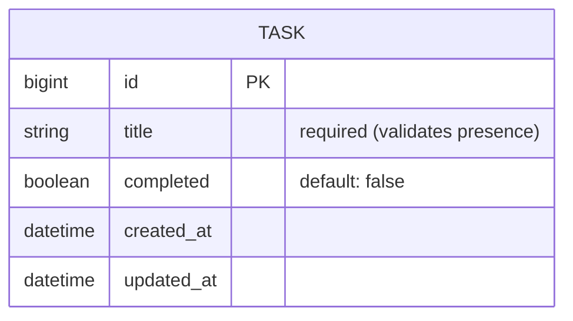
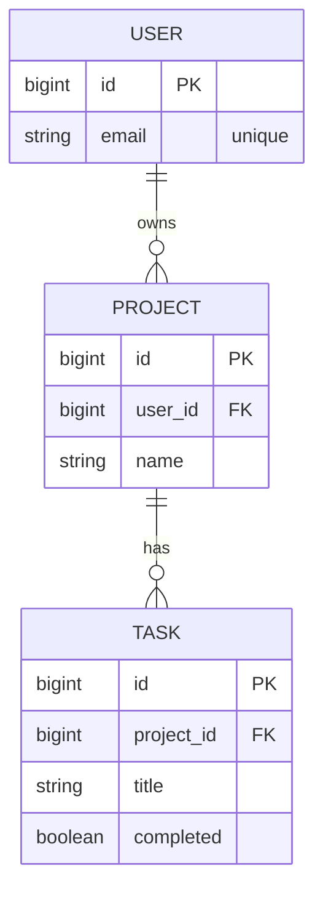

# Hotwire Bootcamp

## Table of Contents

1. [Prerequisites](#1-prerequisites)
2. [What is Hotwire?](#2-what-is-hotwire)
3. [Environment Setup](#3-environment-setup)
4. [Project Structure](#4-project-structure)
5. [SPA vs HTML over the wire](#5-spa-vs-html-over-the-wire)
6. [Turbo Drive](#6-turbo-drive)
7. [Turbo Frames](#7-turbo-frames)
8. [Turbo Streams](#8-turbo-streams)
9. [Broadcasting (Real-time)](#9-broadcasting-real-time)
10. [Page Refresh & Morphing](#10-page-refresh--morphing)
11. [Stimulus](#11-stimulus)
12. [Workshop: Task App](#12-workshop-task-app)
13. [Testing](#13-testing)
14. [Best Practices & Common Pitfalls](#14-best-practices--common-pitfalls)
15. [Resources](#15-resources)

## 1. Prerequisites

**ความรู้พื้นฐานที่จำเป็น:**

- พื้นฐาน Ruby และ Ruby on Rails (MVC, Routing, ActiveRecord)
- ความรู้ HTML/CSS
- พื้นฐาน JavaScript (ES modules, class, event)
- ติดตั้ง Ruby 4 และ Rails 8+
- ติดตั้ง Node.js LTS และ Yarn (ใช้สำหรับ esbuild)
- ติดตั้ง VS Code พร้อม Ruby LSP Extension

## 2. What is Hotwire?

**Hotwire (HTML Over The Wire)** คือแนวทางการสร้างเว็บแอปที่รู้สึกเร็วเหมือน SPA โดยส่ง **HTML** จาก Server แทน **JSON** ทำให้เขียน JavaScript น้อยลงมาก และ logic ส่วนใหญ่ยังอยู่ที่ฝั่ง Server

Hotwire ประกอบด้วย 3 ส่วนหลัก:

| ส่วนประกอบ        | หน้าที่                                                          |
| ----------------- | ---------------------------------------------------------------- |
| **Turbo**         | ทำให้การเปลี่ยนหน้า, การ submit form และการอัปเดตบางส่วนของหน้าเร็วขึ้น โดยไม่ต้องเขียน JS |
| **Stimulus**      | JavaScript framework ขนาดเล็ก สำหรับเพิ่ม behavior ให้ HTML ที่มีอยู่แล้ว |
| **Hotwire Native** | สร้างแอป iOS / Android ที่เป็น native shell แสดงหน้าเว็บจาก Server พร้อม navigation แบบ native |

ส่วน **Turbo** แบ่งย่อยเป็น:

- **Turbo Drive:** เปลี่ยนหน้าโดยไม่ reload ทั้งหน้า
- **Turbo Frames:** อัปเดตเฉพาะบางส่วนของหน้า
- **Turbo Streams:** สั่งเพิ่ม/แก้/ลบ element หลายจุดพร้อมกัน ทั้งจาก HTTP response, WebSocket หรือ SSE

**ทำไมต้อง Hotwire?**

- **Less JavaScript:** ไม่ต้องสร้าง API + Frontend app แยก ลดโค้ดและความซับซ้อน
- **Server is the source of truth:** Business logic, validation, authorization อยู่ที่ Rails ที่เดียว
- **Fast by default:** ได้ความเร็วแบบ SPA จาก Turbo Drive โดยไม่ต้องตั้งค่า
- **Built into Rails:** Rails 7+ ติดตั้ง Hotwire มาให้แล้วตั้งแต่ `rails new` (แต่ Turbo และ Stimulus ใช้กับ backend อื่นได้ ไม่จำเป็นต้องเป็น Rails)
- **Progressive enhancement:** ลิงก์และฟอร์มปกติยังทำงานแบบ HTML ธรรมดาได้แม้ JS ไม่ทำงาน (แต่ `data-turbo-method`, lazy frame และ Stimulus ต้องใช้ JS)

> **Note:** บทความเก่าอาจเรียก Hotwire Native ว่า **Turbo Native** และเรียก Bridge Components ว่า **Strada** ปัจจุบันรวมเป็น Hotwire Native แล้ว

### Hotwire Native (ภาพรวม)

- **Content is all web, navigation is all native:** แอปเป็น native shell (Swift สำหรับ iOS, Kotlin สำหรับ Android) ที่เปิดหน้าเว็บจาก Server ใน web view แต่การเปลี่ยนหน้า, back, modal เป็นแบบ native
- **Deploy เว็บ = อัปเดตแอป:** แก้หน้าเว็บแล้ว deploy ผู้ใช้เห็นทันที ไม่ต้องรอ App Store review
- **Basic navigation:** ลิงก์ใน domain เดียวกัน push หน้าจอ native ใหม่, `data-turbo-action="replace"` แทนที่หน้าจอเดิม, ลิงก์ต่าง domain เปิดใน in-app browser
- **Path configuration:** ไฟล์ JSON ที่มี `settings` และ `rules` กำหนดพฤติกรรมตาม URL (regex) เช่น `/new$` ให้เปิดเป็น modal
- **Bridge Components:** Stimulus controller ฝั่งเว็บคู่กับ component ฝั่ง native (Swift/Kotlin) เพื่อใช้ปุ่ม, เมนู หรือ API ของเครื่องแบบ native (เดิมชื่อ Strada)
- **Native screens:** ค่อย ๆ เปลี่ยนบางหน้าเป็น native เต็มรูปแบบได้เมื่อจำเป็น

> **Tip:** Hotwire ไม่ได้มาแทน React/Angular ในทุกกรณี ถ้า UI มี state ซับซ้อนมาก (เช่น editor, dashboard แบบ interactive สูง) SPA อาจเหมาะกว่า

## 3. Environment Setup

**การตั้งค่าสภาพแวดล้อม:**

```bash
ruby -v               # ruby 4.x
gem install rails -v "~> 8"
rails -v              # Rails 8.x
node -v
yarn -v
```

สร้างโปรเจกต์ใหม่ด้วย **esbuild** (Rails 8 ติดตั้ง Turbo + Stimulus มาให้แล้ว):

```bash
rails new hotwire-bootcamp -j esbuild
cd hotwire-bootcamp
bin/rails db:prepare
bin/dev
```

`bin/dev` จะรัน Rails server และ esbuild แบบ `--watch` พร้อมกัน (ตาม `Procfile.dev`) ทุกครั้งที่แก้ไฟล์ JS, esbuild จะ build ใหม่ไปที่ `app/assets/builds/` ให้อัตโนมัติ

ตรวจสอบว่า Hotwire ถูกติดตั้งแล้ว:

```ruby
# Gemfile
gem "jsbundling-rails"
gem "turbo-rails"
gem "stimulus-rails"
```

```json
// package.json
{
  "scripts": {
    "build": "esbuild app/javascript/*.* --bundle --sourcemap --format=esm --outdir=app/assets/builds --public-path=/assets"
  },
  "dependencies": {
    "@hotwired/stimulus": "...",
    "@hotwired/turbo-rails": "..."
  },
  "devDependencies": {
    "esbuild": "..."
  }
}
```

```js
// app/javascript/application.js
import "@hotwired/turbo-rails"
import "./controllers"
```

```erb
<%# app/views/layouts/application.html.erb %>
<%= javascript_include_tag "application", "data-turbo-track": "reload", type: "module" %>
```

**Importmap vs esbuild:**

| หัวข้อ               | Importmap (default)               | esbuild                                 |
| -------------------- | --------------------------------- | --------------------------------------- |
| ต้องมี Node.js        | ไม่ต้อง                            | ต้อง                                     |
| Build step           | ไม่มี                              | มี (`yarn build`)                         |
| npm packages         | pin ผ่าน `bin/importmap pin`       | `yarn add` ได้ทุก package                 |
| TypeScript / JSX     | ไม่รองรับ                          | รองรับ                                   |
| เหมาะกับ             | แอปที่ใช้ JS น้อย                   | ทีมที่ใช้ npm ecosystem หรือ TypeScript    |

> **Note:** ถ้ามีโปรเจกต์ที่ใช้ importmap อยู่แล้ว เปลี่ยนเป็น esbuild ได้ด้วย `bundle add jsbundling-rails` แล้วรัน `bin/rails javascript:install:esbuild` จากนั้นลบ `importmap-rails`, `config/importmap.rb` และ `javascript_importmap_tags` ใน layout

## 4. Project Structure

**ไฟล์ที่เกี่ยวข้องกับ Hotwire ในโปรเจกต์ Rails 8:**

```
hotwire-bootcamp/
├── app/
│   ├── controllers/                  # Rails controllers (respond_to turbo_stream)
│   ├── models/                       # Models (broadcasts)
│   ├── views/
│   │   ├── layouts/
│   │   │   └── application.html.erb  # javascript_include_tag, turbo meta tags
│   │   └── tasks/
│   │       ├── _task.html.erb        # Partial ที่ใช้ซ้ำทั้งใน frame และ stream
│   │       ├── index.html.erb
│   │       └── create.turbo_stream.erb  # Turbo Stream response
│   ├── assets/
│   │   └── builds/                   # ไฟล์ที่ esbuild build ออกมา (ไม่ต้อง commit)
│   └── javascript/
│       ├── application.js            # Entry point: import Turbo + Stimulus
│       └── controllers/              # Stimulus controllers
│           ├── application.js        # Stimulus application instance
│           ├── index.js              # Register controllers (generate อัตโนมัติ)
│           └── hello_controller.js
├── config/
│   └── cable.yml                     # Action Cable (สำหรับ broadcast)
├── Gemfile
├── package.json                      # JS dependencies + build script ของ esbuild
└── Procfile.dev                      # bin/dev: รัน Rails server + esbuild --watch
```

**คำอธิบายไฟล์สำคัญ:**

- **`app/javascript/application.js`**: Entry point ของ JavaScript
  - esbuild bundle ไฟล์นี้พร้อมทุกไฟล์ที่ import ไปเป็น `app/assets/builds/application.js`

- **`app/javascript/controllers/index.js`**: Register Stimulus controllers
  - esbuild ไม่รองรับการโหลดไฟล์แบบ auto-load จึงต้อง import และ register controller ทีละตัว
  - `bin/rails generate stimulus` จะอัปเดตไฟล์นี้ให้อัตโนมัติ ถ้าสร้างไฟล์ controller เอง ให้รัน `bin/rails stimulus:manifest:update`

```js
// app/javascript/controllers/index.js
// This file is auto-generated by ./bin/rails stimulus:manifest:update
import { application } from "./application"

import HelloController from "./hello_controller"
application.register("hello", HelloController)
```

- **`package.json`**: จัดการ JavaScript dependencies
  - ติดตั้ง package ด้วย `yarn add <package>` แล้ว import ใน JS ได้เลย

- **`app/views/**/*.turbo_stream.erb`**: Template สำหรับตอบกลับเป็น Turbo Stream
  - ใช้เมื่อต้องการอัปเดตหลายจุดในหน้าหลัง submit form

## 5. SPA vs HTML over the wire

- **SPA (เช่น Angular, React):** Server ส่ง **JSON** → Browser รัน JavaScript เพื่อสร้าง HTML เอง → ต้องมี state, routing, validation ซ้ำทั้งสองฝั่ง

- **Hotwire:** Server render **HTML** ให้เลย → Turbo นำ HTML ที่ได้ไปแทนที่ในหน้าเว็บ → logic อยู่ที่ Server ที่เดียว

```
SPA
Browser ──(fetch /api/tasks)──▶ Server
Browser ◀──── JSON ─────────── Server
Browser: JSON → render HTML ด้วย JS framework

Hotwire
Browser ──(GET /tasks)───────▶ Server
Browser ◀──── HTML ─────────── Server (render ERB)
Turbo: เอา HTML ไปแทนที่ <body> / <turbo-frame> / target ที่กำหนด
```

| หัวข้อ             | SPA                         | Hotwire                       |
| ------------------ | --------------------------- | ----------------------------- |
| Data format        | JSON                        | HTML                          |
| Rendering          | Client                      | Server                        |
| Routing            | Client + Server             | Server                        |
| Validation         | ทั้งสองฝั่ง                  | Server                        |
| JavaScript ที่เขียน | มาก                         | น้อย (เฉพาะ Stimulus)          |
| เหมาะกับ           | UI ที่มี client state ซับซ้อนมาก, offline | CRUD app, admin, SaaS ทั่วไป, mobile app ผ่าน Hotwire Native |

## 6. Turbo Drive

Turbo Drive จะ **ดักการคลิกลิงก์และการ submit form ที่ไป origin เดียวกัน** แล้วส่ง request ด้วย `fetch` จากนั้นนำ `<body>` ใหม่มาแทนที่ของเดิม และ merge `<head>` ให้ **โดยไม่ reload ทั้งหน้า**

ผลลัพธ์คือ CSS/JS ไม่ต้องโหลดใหม่ทุกครั้ง หน้าเว็บจึงรู้สึกเร็วเหมือน SPA

**ไม่ต้องเขียนโค้ดเพิ่ม** แค่ import `@hotwired/turbo-rails` ก็ทำงานทันที

### Visit actions: advance vs replace

- **Application visit:** คลิกลิงก์ → Turbo เพิ่มประวัติใน browser history (`advance` เป็นค่า default)
- **Restoration visit:** กด Back/Forward → Turbo แสดงหน้าจาก cache ทันที
- **`replace`:** แทนที่ history entry ปัจจุบัน ไม่เพิ่มรายการใหม่

```erb
<%= link_to "Next step", step_path(2), data: { turbo_action: "replace" } %>
```

สั่ง visit จาก JavaScript:

```js
import { Turbo } from "@hotwired/turbo-rails"

Turbo.visit("/tasks", { action: "replace" })
```

### ปิด Turbo Drive เฉพาะจุด

```erb
<%# หน้าที่ใช้ JS library เก่าซึ่งต้อง reload ทั้งหน้า %>
<%= link_to "Legacy report", legacy_report_path, data: { turbo: false } %>

<%# ฟอร์มที่ redirect ไป origin อื่น เช่น payment gateway ภายนอก %>
<%= form_with url: checkout_path, data: { turbo: false } do |f| %>
  ...
<% end %>
```

> **Note:** Turbo ข้าม URL ที่มีนามสกุลไฟล์ (เช่น `/report.pdf`, `/data.json`), ลิงก์ที่มี `download` และลิงก์ไป origin อื่นให้อัตโนมัติ ไม่ต้องใส่ `data-turbo="false"`

### Link ที่ใช้ HTTP method อื่น

```erb
<%= link_to "Delete", task_path(task),
      data: { turbo_method: :delete, turbo_confirm: "ลบใช่ไหม?" } %>

<%# แนะนำใช้ button_to สำหรับ action ที่เปลี่ยนข้อมูล %>
<%= button_to "Delete", task_path(task), method: :delete,
      form: { data: { turbo_confirm: "ลบใช่ไหม?" } } %>
```

### Form submission rules

Turbo Drive ต้องการ response ที่ถูกต้องหลัง submit form:

- **สำเร็จ:** หลัง submit ที่ไม่ใช่ GET (POST, PATCH, DELETE) ให้ตอบ **redirect 303 See Other**
- **ไม่ผ่าน validation:** render ฟอร์มพร้อม status **4xx** (นิยมใช้ 422) Turbo จะ render ทุก response ที่เป็น 4xx/5xx
- **ห้ามตอบ 200 กับ POST โดยไม่ redirect:** Turbo จะไม่ render หน้านั้น เพราะ browser จะทำ Back/Refresh ไม่ถูกต้อง

```ruby
def create
  @task = Task.new(task_params)

  if @task.save
    redirect_to tasks_path, notice: "Task created.", status: :see_other
  else
    # ต้องส่ง 422 ไม่อย่างนั้น Turbo จะไม่ render error
    # (:unprocessable_content คือ 422 ชื่อใหม่ตั้งแต่ Rack 3.1, :unprocessable_entity ถูก deprecate แล้ว)
    render :new, status: :unprocessable_content
  end
end

def destroy
  @task.destroy
  redirect_to tasks_path, status: :see_other
end
```

ระหว่าง submit Turbo จะ disable ปุ่ม submit ให้อัตโนมัติ และเปลี่ยนข้อความปุ่มได้ด้วย `data-turbo-submits-with`:

```erb
<%= f.submit "Save", data: { turbo_submits_with: "Saving..." } %>
```

### Prefetch และ Asset tracking

- **Prefetch:** Turbo 8 จะ prefetch ลิงก์เมื่อ hover ค้างไว้ประมาณ 100ms ทำให้คลิกแล้วแสดงผลแทบทันที
- **`data-turbo-track="reload"`:** ถ้า URL ของไฟล์ CSS/JS เปลี่ยน (Rails ใส่ digest ให้แล้ว เช่นหลัง deploy) Turbo จะ reload ทั้งหน้าในการเปลี่ยนหน้าครั้งถัดไป

```erb
<%= stylesheet_link_tag :app, "data-turbo-track": "reload" %>

<%# ปิด prefetch เฉพาะลิงก์ %>
<%= link_to "Heavy page", heavy_path, data: { turbo_prefetch: false } %>

<%# ปิด prefetch ทั้งเว็บ (ใส่ใน <head>) %>
<meta name="turbo-prefetch" content="false">
```

> **Security:** เพราะ prefetch ยิง GET แค่ตอน hover ทุก GET route ต้อง **ไม่มี side effect** (ไม่สร้าง/แก้/ลบข้อมูล) action ที่เปลี่ยนข้อมูลให้ใช้ `button_to` หรือฟอร์ม POST/PATCH/DELETE

### Cache และ Restoration visits

Turbo เก็บ snapshot ของหน้าไว้ใน cache เพื่อแสดงทันทีตอนกด Back/Forward และแสดงเป็น preview ระหว่างโหลดหน้าที่เคยเปิด จึงต้องระวัง element ที่ไม่ควรกลับมาอีก:

```erb
<%# flash message ไม่ควรโผล่อีกตอนกด Back %>
<div id="flash" data-turbo-temporary>
  <%= notice %>
</div>
```

```erb
<%# หน้าที่ข้อมูลเปลี่ยนบ่อย: ไม่ใช้ cache เลย (ใส่ meta turbo-cache-control ลงใน <head>) %>
<% turbo_exempts_page_from_cache %>

<%# หรือไม่แสดง preview แต่ยังใช้ cache ตอน Back %>
<% turbo_exempts_page_from_preview %>
```

ถ้าต้อง reset state ของ JS ก่อนเก็บ snapshot ให้ฟัง `turbo:before-cache` (Stimulus ส่วนใหญ่จัดการผ่าน `disconnect()` ได้)

### Persist element ข้ามหน้า

`data-turbo-permanent` ทำให้ element ที่มี **id เดียวกัน** ไม่ถูกแทนที่เมื่อเปลี่ยนหน้า เช่น ตัวนับตะกร้าสินค้า หรือ audio player:

```erb
<div id="cart-counter" data-turbo-permanent>1 item</div>
```

### Turbo events

เพราะหน้าไม่ได้ reload จริง `DOMContentLoaded` จะทำงานแค่ครั้งแรก ให้ใช้ `turbo:load` แทน (หรือดีกว่านั้นคือใช้ Stimulus)

```js
document.addEventListener("turbo:load", () => {
  console.log("page loaded")
})
```

**Events ที่ใช้บ่อย:**

| Event                         | เกิดเมื่อ                                                     |
| ----------------------------- | ----------------------------------------------------------- |
| `turbo:load`                  | โหลดหน้าครั้งแรกและหลังทุก visit                               |
| `turbo:before-visit`          | ก่อนเริ่ม visit (เรียก `event.preventDefault()` เพื่อยกเลิกได้)   |
| `turbo:before-cache`          | ก่อนเก็บ snapshot ลง cache                                    |
| `turbo:before-render`         | ก่อน render หน้าใหม่                                          |
| `turbo:before-fetch-request`  | ก่อนส่ง request (เพิ่ม header ได้)                              |
| `turbo:submit-start` / `turbo:submit-end` | เริ่ม/จบการ submit form (`event.detail.success`)  |
| `turbo:frame-load`            | frame โหลดเนื้อหาเสร็จ                                        |
| `turbo:frame-missing`         | response ไม่มี frame id ที่ตรงกัน                               |
| `turbo:before-stream-render`  | ก่อนทำ Turbo Stream action                                   |

**เขียน JS ให้เข้ากับ Turbo Drive:**

- หน้าเว็บไม่ reload จริง JS bundle ต้องโหลดใน `<head>` (Rails ทำให้แล้ว) และ `<script>` ใน `<body>` จะถูกรันใหม่ทุกครั้งที่ render
- โค้ดที่แก้ DOM ต้องรันซ้ำได้ปลอดภัย เพราะหน้าอาจถูกแสดงจาก cache
- ใช้ Stimulus แทนการผูก event listener ใน `turbo:load`

> **Best Practice:** หลีกเลี่ยงการเขียน JS ใน `turbo:load` ให้ย้ายไปเป็น Stimulus controller ซึ่งมี `connect()` / `disconnect()` ที่ทำงานถูกต้องเสมอ

## 7. Turbo Frames

Turbo Frames คือการแบ่งหน้าเว็บเป็น **ส่วนย่อยที่อัปเดตแยกกันได้** ลิงก์และฟอร์มภายใน frame จะอัปเดตเฉพาะ frame นั้น ไม่ใช่ทั้งหน้า

**หลักการ:** Server ส่ง HTML กลับมา (ทั้งหน้าหรือแค่บางส่วนก็ได้) → Turbo หา `<turbo-frame>` ที่มี **id เดียวกัน** → นำ**เนื้อหาข้างใน**ไปแทนที่เนื้อหาของ frame เดิม ส่วนอื่นของ response ถูกทิ้ง

### Inline edit

```erb
<%# app/views/tasks/_task.html.erb %>
<%= turbo_frame_tag task do %>
  <p><%= task.title %></p>
  <%= link_to "Edit", edit_task_path(task) %>
<% end %>
```

```erb
<%# app/views/tasks/edit.html.erb %>
<h1>Edit task</h1>

<%= turbo_frame_tag @task do %>
  <%= render "form", task: @task %>
<% end %>
```

`turbo_frame_tag task` จะสร้าง `<turbo-frame id="task_1">` ให้อัตโนมัติ (ใช้ `dom_id`)

เมื่อคลิก "Edit" → Turbo โหลด `/tasks/1/edit` → ดึงเฉพาะ `<turbo-frame id="task_1">` มาแทนที่ → ได้ inline edit โดยไม่ต้องเขียน JS เลย

### Eager และ Lazy loading

frame ที่มี `src` จะโหลดเนื้อหาจาก URL นั้นทันทีหลังหน้าโหลด (eager) ถ้าใส่ `loading: :lazy` จะโหลดเมื่อ frame เลื่อนเข้ามาในจอ เหมาะกับส่วนที่ query ช้า:

```erb
<%= turbo_frame_tag "stats", src: stats_path, loading: :lazy do %>
  <p>Loading...</p>
<% end %>
```

response ของ `stats_path` ต้องมี `turbo_frame_tag "stats"` (ไม่ต้องใส่ `src`) อยู่ข้างใน

ระหว่างโหลด frame จะมี attribute `busy` และ `aria-busy="true"` ใช้ทำ loading state ด้วย CSS ได้:

```css
turbo-frame[aria-busy="true"] { opacity: 0.5; }
```

### ควบคุม frame จากภายนอก

ลิงก์หรือฟอร์มที่อยู่นอก frame สั่งให้อัปเดต frame ได้ด้วย `data-turbo-frame` เช่น ฟอร์มค้นหาที่แสดงผลใน frame `results`:

```erb
<%= form_with url: tasks_path, method: :get,
      data: { turbo_frame: "results", turbo_action: "advance" } do |f| %>
  <%= f.search_field :q %>
<% end %>

<%= turbo_frame_tag "results" do %>
  <%= render @tasks %>
<% end %>
```

`turbo_action: "advance"` ทำให้ URL ใน address bar เปลี่ยนตามคำค้น กด Back แล้วกลับไปผลค้นหาก่อนหน้าได้

### Navigate ออกนอก frame

```erb
<%# ลิงก์นี้อยู่ใน frame แต่ต้องการเปลี่ยนทั้งหน้า %>
<%= link_to "View", task_path(task), data: { turbo_frame: "_top" } %>

<%# ให้ทุกลิงก์ใน frame เปลี่ยนทั้งหน้า %>
<%= turbo_frame_tag "nav", target: "_top" do %>
  ...
<% end %>

<%# อัปเดต URL ใน address bar ด้วย %>
<%= turbo_frame_tag "results", data: { turbo_action: "advance" } do %>
  ...
<% end %>
```

> **Note:** ถ้า response ไม่มี frame id ที่ตรงกัน จะเห็นข้อความ **"Content missing"** และเกิด event `turbo:frame-missing` ให้ตรวจว่า id ของ frame ทั้งสองหน้าตรงกัน

### Breaking out ออกจาก frame

กรณีที่พบบ่อย: session หมดอายุ ระหว่างกดลิงก์ใน frame แล้วถูก redirect ไปหน้า login ซึ่งไม่มี frame → เห็น "Content missing" แก้โดยให้หน้า login สั่ง reload ทั้งหน้า:

```erb
<%# app/views/sessions/new.html.erb (ใส่ meta turbo-visit-control ลงใน <head>) %>
<% turbo_page_requires_reload %>
```

## 8. Turbo Streams

Turbo Streams ใช้เมื่อต้องการ **อัปเดตหลายจุดในหน้าพร้อมกัน** target เป็น element ไหนก็ได้ที่มี id ไม่จำเป็นต้องเป็น `<turbo-frame>`

Turbo Stream คือ HTML element ที่บอกว่า "ทำ action อะไร กับ element id ไหน":

```html
<turbo-stream action="prepend" target="tasks">
  <template>
    <div id="task_5">Buy milk</div>
  </template>
</turbo-stream>
```

### Actions

| Action    | ผลลัพธ์                                   |
| --------- | ----------------------------------------- |
| `append`  | เพิ่มต่อท้ายใน target                      |
| `prepend` | เพิ่มไว้ด้านบนใน target                    |
| `replace` | แทนที่ target ทั้ง element                 |
| `update`  | แทนที่เฉพาะเนื้อหาข้างใน target              |
| `remove`  | ลบ target                                 |
| `before`  | เพิ่มก่อน target                           |
| `after`   | เพิ่มหลัง target                           |
| `refresh` | สั่ง page refresh (จะ morph ถ้าหน้าตั้ง `turbo_refreshes_with method: :morph`) |

### ตอบกลับ Turbo Stream จาก Controller

```ruby
def create
  @task = Task.new(task_params)

  respond_to do |format|
    if @task.save
      format.turbo_stream  # render create.turbo_stream.erb
      format.html { redirect_to tasks_path, status: :see_other }
    else
      format.html { render :new, status: :unprocessable_content }
    end
  end
end
```

```erb
<%# app/views/tasks/create.turbo_stream.erb %>
<%= turbo_stream.prepend "tasks", @task %>
<%= turbo_stream.update "task_count", Task.count %>
<%= turbo_stream.update "flash", partial: "shared/flash", locals: { notice: "Task created." } %>
```

`turbo_stream.prepend "tasks", @task` จะ render partial `tasks/_task.html.erb` ให้อัตโนมัติ

**Turbo ขอ Turbo Stream เมื่อไหร่?** ตอน submit ฟอร์มที่ไม่ใช่ GET Turbo จะเพิ่ม `text/vnd.turbo-stream.html` ใน `Accept` header ให้ `format.turbo_stream` จึงทำงานได้ ส่วนลิงก์หรือฟอร์ม GET ต้องขอเองด้วย `data: { turbo_stream: true }`

### Target หลาย element และ morph

```erb
<%# targets = CSS selector อัปเดตทุก element ที่ตรง %>
<%= turbo_stream.update_all ".task-count", Task.count %>
<%= turbo_stream.remove_all ".completed-task" %>

<%# morph แทนการแทนที่ทั้งก้อน (รักษา focus/state ของ element ข้างใน) %>
<%= turbo_stream.replace @task, method: :morph %>
```

### Inline ใน controller (กรณีสั้น ๆ)

```ruby
def destroy
  @task.destroy

  respond_to do |format|
    format.turbo_stream { render turbo_stream: turbo_stream.remove(@task) }
    format.html { redirect_to tasks_path, status: :see_other }
  end
end
```

> **Best Practice:** ใส่ `format.html` ไว้เสมอเพื่อ fallback กรณีที่ไม่ได้ request ผ่าน Turbo

### Frames vs Streams ใช้อันไหน?

| สถานการณ์                                 | ใช้          |
| ---------------------------------------- | ------------ |
| อัปเดตส่วนเดียว เช่น inline edit, tabs, pagination | Turbo Frame  |
| อัปเดตหลายจุดพร้อมกัน                       | Turbo Stream |
| อัปเดต real-time ให้ผู้ใช้คนอื่น                | Turbo Stream + Broadcast |

## 9. Broadcasting (Real-time)

Turbo Streams สามารถส่งผ่าน **WebSocket (Action Cable)** ได้ ทำให้ผู้ใช้ทุกคนที่เปิดหน้าเดียวกันเห็นการเปลี่ยนแปลงทันที

Rails 8 ใช้ **Solid Cable** เป็น adapter ของ Action Cable ใน production โดย default จึงไม่ต้องมี Redis (ตอน development ใช้ adapter `async` ดูได้ที่ `config/cable.yml`)

### 1) Model: broadcast เมื่อข้อมูลเปลี่ยน

```ruby
class Task < ApplicationRecord
  belongs_to :project

  # create → prepend, update → replace, destroy → remove
  broadcasts_to :project, inserts_by: :prepend
end
```

หรือเขียนแบบ explicit:

```ruby
class Task < ApplicationRecord
  belongs_to :project

  after_create_commit  -> { broadcast_prepend_later_to project, target: "tasks" }
  after_update_commit  -> { broadcast_replace_later_to project }
  after_destroy_commit -> { broadcast_remove_to project }
end
```

### 2) View: subscribe stream

```erb
<%# app/views/projects/show.html.erb %>
<%= turbo_stream_from @project %>

<div id="tasks">
  <%= render @project.tasks %>
</div>
```

> **Security:** Stream name ถูก sign โดย Rails ผู้ใช้จึงปลอมชื่อ stream เองไม่ได้ แต่ใครก็ตามที่เปิดหน้านั้นได้จะได้รับ broadcast ด้วย ให้ **scope stream ตามสิทธิ์** (เช่น ต่อ project หรือต่อ user) และอย่า broadcast ข้อมูล sensitive ไปยัง stream ที่ใช้ร่วมกัน

> **Tip:** ใช้ method ที่ลงท้ายด้วย `_later` เพื่อ render และส่งผ่าน background job ไม่ block request

## 10. Page Refresh & Morphing

Turbo 8 เพิ่ม **page refresh** คือการโหลด**หน้าเดิมซ้ำ** เช่น ฟอร์ม redirect กลับมาที่ URL เดิม หรือได้รับ stream action `refresh` (การเปลี่ยนไปหน้าอื่นตามปกติไม่นับ)

ค่า default ของ page refresh คือแทนที่ `<body>` ทั้งหมด (`replace`) และ scroll กลับไปบนสุด (`reset`) ถ้าเปิด **morph** Turbo จะเปรียบเทียบ DOM เก่ากับใหม่ แล้วเปลี่ยนเฉพาะส่วนที่ต่างกัน และถ้าตั้ง `scroll: :preserve` จะรักษาตำแหน่ง scroll ไว้:

```erb
<%# app/views/layouts/application.html.erb (ใน <head>) %>
<%= turbo_refreshes_with method: :morph, scroll: :preserve %>
```

ใช้ร่วมกับ broadcast:

```ruby
class Task < ApplicationRecord
  belongs_to :project
  broadcasts_refreshes_to :project
end
```

```erb
<%= turbo_stream_from @project %>
```

เมื่อ task เปลี่ยน → ทุกคนที่เปิดหน้า project ได้รับคำสั่ง `refresh` → หน้าโหลด HTML ใหม่แล้ว morph เฉพาะส่วนที่ต่างกัน

ป้องกันไม่ให้ element ถูก morph (เช่น form ที่ผู้ใช้กำลังพิมพ์) ด้วย `data-turbo-permanent` (มีผลกับการเปลี่ยนหน้าปกติด้วย ดู [Persist element ข้ามหน้า](#persist-element-ข้ามหน้า)):

```erb
<div id="draft" data-turbo-permanent>...</div>
```

frame ที่โหลดเนื้อหาจาก `src` ให้ใส่ `refresh: "morph"` เพื่อให้ frame โหลดเนื้อหาใหม่แบบ morph ด้วยเมื่อเกิด page refresh:

```erb
<%= turbo_frame_tag "comments", src: comments_path, refresh: "morph" %>
```

> **Best Practice:** เริ่มจาก **morphing + `broadcasts_refreshes`** ก่อน เพราะเขียนน้อยที่สุด แล้วค่อยเปลี่ยนไปใช้ Turbo Stream action เฉพาะจุดเมื่อมีปัญหาเรื่อง performance

## 11. Stimulus

Stimulus คือ JavaScript framework ขนาดเล็กที่ **เพิ่ม behavior ให้ HTML ที่ Server render มาแล้ว** ไม่ได้ render HTML เอง

แนวคิด: HTML เป็นตัวบอกว่าจะใช้ controller อะไร ผ่าน `data-*` attributes และ **state เก็บอยู่ใน HTML** (data attributes) ไม่ใช่ใน JavaScript object

### Identifier และชื่อไฟล์

ชื่อไฟล์ controller ถูกแปลงเป็น **identifier** (kebab-case) ที่ใช้ใน HTML:

| ไฟล์                                  | Identifier          |
| ------------------------------------- | ------------------- |
| `hello_controller.js`                 | `hello`             |
| `auto_submit_controller.js`           | `auto-submit`       |
| `users/list_item_controller.js`       | `users--list-item`  |

ใน JavaScript ใช้ camelCase ส่วนใน HTML ใช้ kebab-case เช่น value `contentType` → `data-loader-content-type-value`

ใส่หลาย controller บน element เดียวได้ด้วยการเว้นวรรค `data-controller="clipboard tooltip"` และแต่ละ element จะได้ controller instance ของตัวเอง

### Core concepts

| Concept        | Attribute                              | หน้าที่                            |
| -------------- | -------------------------------------- | -------------------------------- |
| **Controller** | `data-controller="counter"`            | ผูก JS class กับ element          |
| **Action**     | `data-action="click->counter#increment"` | ผูก event กับ method              |
| **Target**     | `data-counter-target="output"`         | อ้างอิง element ภายใน controller  |
| **Value**      | `data-counter-count-value="0"`         | state ที่อ่าน/เขียนได้ (sync กับ attribute) |
| **Class**      | `data-counter-active-class="is-active"` | ส่งชื่อ CSS class เข้า controller |
| **Outlet**     | `data-counter-modal-outlet="#modal"`   | อ้างอิง controller อื่น            |

`this.element` คือ element ที่มี `data-controller` ส่วน controller จะมองเห็นเฉพาะ element นั้นและลูก ๆ ของมัน

### Actions

รูปแบบ `event->controller#method:option`:

```erb
<button data-action="click->counter#increment">+</button>

<%# ไม่ระบุ event ได้ ถ้าเป็น default event ของ element นั้น %>
<button data-action="counter#increment">+</button>

<%# หลาย action คั่นด้วยเว้นวรรค %>
<input data-action="focus->search#open input->search#query">
```

**Default events:**

| Element                     | Default event |
| --------------------------- | ------------- |
| `a`, `button`               | `click`       |
| `form`                      | `submit`      |
| `input`, `textarea`         | `input` (`input type="submit"` เป็น `click`) |
| `select`                    | `change`      |
| `details`                   | `toggle`      |

**Action options, keyboard filter และ global events:**

```erb
<%# :prevent = event.preventDefault(), :stop = event.stopPropagation() %>
<a href="#" data-action="click->menu#toggle:prevent">Menu</a>

<%# :once = ทำครั้งเดียว, :self = เฉพาะเมื่อ event เกิดที่ element นี้เอง %>
<div data-action="click->modal#close:self">...</div>

<%# keyboard filter %>
<input data-action="keydown.enter->search#submit keydown.esc->search#clear">

<%# ฟัง event ของ window / document %>
<div data-controller="layout" data-action="resize@window->layout#recalculate"></div>
```

**Action parameters:** ส่งค่าให้ method ผ่าน `data-[identifier]-[name]-param` (ต้องอยู่บน element เดียวกับ `data-action`) Stimulus แปลง type ให้อัตโนมัติ:

```erb
<button data-action="cart#add" data-cart-id-param="42">Add</button>
```

```js
add({ params: { id } }) {
  console.log(id) // 42 (Number)
}
```

### Targets

```js
static targets = ["item"]

this.itemTarget     // element แรก (throw error ถ้าไม่มี)
this.itemTargets    // array ของทุก element
this.hasItemTarget  // true / false
```

### Values

```js
static values = {
  url: String,                              // default ""
  count: Number,                            // default 0
  open: Boolean,                            // default false ("false" หรือ "0" = false)
  ids: Array,                               // default [] (เขียนใน HTML เป็น JSON)
  options: Object,                          // default {} (เขียนใน HTML เป็น JSON)
  delay: { type: Number, default: 300 },    // กำหนด default เอง
}
```

- อ่าน: `this.urlValue`, เช็คว่ามี attribute ไหม: `this.hasUrlValue`
- เขียน: `this.countValue = 5` จะเขียนกลับไปที่ `data-*-count-value` ด้วย
- `[name]ValueChanged(value, previousValue)` ถูกเรียก**ครั้งแรกตอน controller เริ่มทำงาน** และทุกครั้งที่ค่าเปลี่ยน

### ตัวอย่าง: Counter

สร้าง controller:

```bash
bin/rails generate stimulus counter
```

คำสั่งนี้จะสร้าง `counter_controller.js` และ register ใน `controllers/index.js` ให้อัตโนมัติ

```js
// app/javascript/controllers/counter_controller.js
import { Controller } from "@hotwired/stimulus"

export default class extends Controller {
  static targets = ["output"]
  static values = { count: Number }

  increment() {
    this.countValue++
  }

  // ถูกเรียกครั้งแรกตอนเริ่มทำงาน (span จึงแสดง 5 ทันที) และทุกครั้งที่ countValue เปลี่ยน
  countValueChanged() {
    this.outputTarget.textContent = this.countValue
  }
}
```

```erb
<div data-controller="counter" data-counter-count-value="5">
  <p>Count: <span data-counter-target="output"></span></p>
  <button data-action="click->counter#increment">Increment</button>
</div>
```

### Lifecycle

| Callback       | เรียกเมื่อ                                                                    |
| -------------- | --------------------------------------------------------------------------- |
| `initialize()` | สร้าง controller instance (ครั้งเดียว)                                         |
| `connect()`    | controller เชื่อมกับ document (เกิดได้หลายครั้ง เช่น หลัง Turbo เปลี่ยนหน้าหรือแสดงจาก cache) |
| `disconnect()` | controller หลุดจาก document (element ถูกลบ, parent ถูกแทนที่ หรือลบ `data-controller`) |

ตัวอย่าง: ต้อง cleanup resource ที่สร้างใน `connect()` เสมอ

```js
// app/javascript/controllers/refresh_controller.js
import { Controller } from "@hotwired/stimulus"

export default class extends Controller {
  static values = { interval: { type: Number, default: 5000 } }

  connect() {
    this.timer = setInterval(() => this.element.reload(), this.intervalValue)
  }

  disconnect() {
    clearInterval(this.timer)
  }
}
```

```erb
<%# reload() เป็น method ของ <turbo-frame> ที่มี src %>
<%= turbo_frame_tag "stats", src: stats_path,
      data: { controller: "refresh", refresh_interval_value: 10000 } %>
```

มี callback สำหรับ target ด้วย: `[name]TargetConnected(element)` และ `[name]TargetDisconnected(element)`

### CSS Classes

ส่งชื่อ CSS class จาก HTML (ต้องอยู่บน element เดียวกับ `data-controller`) แทนการ hardcode ใน JS:

```js
static classes = ["active"]

toggle() {
  this.element.classList.toggle(this.activeClass)
}
```

```erb
<div data-controller="toggle" data-toggle-active-class="bg-blue-500">...</div>
```

### สื่อสารระหว่าง controller

**`this.dispatch()`** ส่ง custom event (ชื่อขึ้นต้นด้วย identifier อัตโนมัติ) แล้วให้ controller อื่นฟังผ่าน `data-action`:

```js
// clipboard_controller.js
copy() {
  navigator.clipboard.writeText(this.sourceTarget.value)
  this.dispatch("copied", { detail: { content: this.sourceTarget.value } })
}
```

```erb
<div data-controller="clipboard" data-action="clipboard:copied->toast#show">...</div>
```

**Outlets** อ้างอิง controller อื่นด้วย CSS selector (element ปลายทางต้องมี `data-controller` ตรงกัน):

```js
static outlets = ["modal"]

open() {
  this.modalOutlet.show() // this.modalOutlets, this.hasModalOutlet ก็มี
}
```

```erb
<button data-controller="trigger" data-trigger-modal-outlet="#signup" data-action="trigger#open">Sign up</button>
<div id="signup" data-controller="modal">...</div>
```

### ตัวอย่าง: Auto-submit form

```js
// app/javascript/controllers/auto_submit_controller.js
import { Controller } from "@hotwired/stimulus"

export default class extends Controller {
  submit() {
    this.element.requestSubmit()
  }
}
```

```erb
<%= form_with model: task, data: { controller: "auto-submit" } do |f| %>
  <%= f.checkbox :completed, data: { action: "change->auto-submit#submit" } %>
<% end %>
```

### ตัวอย่าง: Reset form หลัง submit สำเร็จ

ฟัง Turbo event ได้โดยตรงจาก `data-action`:

```js
// app/javascript/controllers/reset_form_controller.js
import { Controller } from "@hotwired/stimulus"

export default class extends Controller {
  reset(event) {
    if (event.detail.success) this.element.reset()
  }
}
```

```erb
<%= form_with model: Task.new,
      data: { controller: "reset-form", action: "turbo:submit-end->reset-form#reset" } do |f| %>
  ...
<% end %>
```

> **Best Practice:** เขียน controller ให้เล็กและ reusable (เช่น `auto-submit`, `clipboard`, `toggle`) แทนการเขียน controller ผูกกับหน้าใดหน้าหนึ่ง

## 12. Workshop: Task App

สร้าง Task app ที่มี inline edit, เพิ่มงานโดยไม่ reload, toggle สถานะ และ real-time

### ER Diagram

Workshop นี้ใช้ตารางเดียวคือ `tasks`:



**ต่อยอด:** ตัวอย่างในหัวข้อ [Broadcasting](#9-broadcasting-real-time) และ [Page Refresh & Morphing](#10-page-refresh--morphing) ใช้ `Project` ที่มีหลาย `Task` และผูกกับ `User` เพื่อ scope stream ตามเจ้าของ:



| Relationship        | Rails association                                             | Turbo stream                              |
| ------------------- | ------------------------------------------------------------- | ----------------------------------------- |
| User → Projects     | `User has_many :projects` / `Project belongs_to :user`        | `turbo_stream_from current_user, :projects` |
| Project → Tasks     | `Project has_many :tasks` / `Task belongs_to :project`        | `turbo_stream_from @project`              |

```bash
bin/rails generate model Project user:references name:string
bin/rails generate model Task project:references title:string completed:boolean
```

> **Note:** ตาราง `users` ต้องมีก่อนสร้าง `Project` เช่น `bin/rails generate model User email:string:uniq` (ถ้าใช้ `bin/rails generate authentication` ของ Rails 8 column จะชื่อ `email_address`) ส่วน `references` สร้าง foreign key และ index ให้อัตโนมัติ ส่วน `completed` ควรตั้ง `default: false, null: false` ใน migration

### Step 1: Scaffold

```bash
bin/rails generate scaffold Task title:string completed:boolean
```

แก้ migration ให้ `completed` มีค่า default ก่อน migrate:

```ruby
# db/migrate/xxxxxxxxxxxxxx_create_tasks.rb
t.boolean :completed, default: false, null: false
```

```bash
bin/rails db:migrate
```

### Step 2: Stimulus controller สำหรับ toggle สถานะ

```bash
bin/rails generate stimulus auto_submit
```

```js
// app/javascript/controllers/auto_submit_controller.js
import { Controller } from "@hotwired/stimulus"

export default class extends Controller {
  submit() {
    this.element.requestSubmit()
  }
}
```

### Step 3: Partial ที่ครอบด้วย Frame

```erb
<%# app/views/tasks/_task.html.erb %>
<%= turbo_frame_tag task do %>
  <div>
    <%= form_with model: task, data: { controller: "auto-submit" } do |f| %>
      <%= f.checkbox :completed, data: { action: "change->auto-submit#submit" } %>
    <% end %>

    <span><%= task.title %></span>

    <%= link_to "Edit", edit_task_path(task) %>
    <%= button_to "Delete", task, method: :delete,
          form: { data: { turbo_confirm: "ลบใช่ไหม?" } } %>
  </div>
<% end %>
```

แก้หน้า edit ให้มี frame id เดียวกัน (ถ้าไม่แก้ กด Edit แล้วจะเห็น "Content missing"):

```erb
<%# app/views/tasks/edit.html.erb %>
<h1>Edit task</h1>

<%= turbo_frame_tag @task do %>
  <%= render "form", task: @task %>
<% end %>
```

### Step 4: Index พร้อมฟอร์มสร้างงานและ stream

```erb
<%# app/views/tasks/index.html.erb %>
<%= turbo_stream_from "tasks" %>

<h1>Tasks</h1>

<%# target ของ stream เป็น div ธรรมดาได้ ไม่ต้องใช้ turbo_frame_tag %>
<div id="new_task">
  <%= render "form", task: Task.new %>
</div>

<div id="tasks">
  <%= render @tasks %>
</div>
```

### Step 5: Controller

```ruby
class TasksController < ApplicationController
  before_action :set_task, only: %i[show edit update destroy]

  def index
    @tasks = Task.order(created_at: :desc)
  end

  def create
    @task = Task.new(task_params)

    respond_to do |format|
      if @task.save
        format.turbo_stream
        format.html { redirect_to tasks_path, notice: "Task created.", status: :see_other }
      else
        format.turbo_stream do
          render turbo_stream: turbo_stream.update("new_task", partial: "tasks/form", locals: { task: @task }),
                 status: :unprocessable_content
        end
        format.html { render :new, status: :unprocessable_content }
      end
    end
  end

  def update
    if @task.update(task_params)
      redirect_to @task, status: :see_other  # show.html.erb render _task ซึ่งมี frame id เดียวกัน
    else
      render :edit, status: :unprocessable_content
    end
  end

  def destroy
    @task.destroy

    respond_to do |format|
      format.turbo_stream { render turbo_stream: turbo_stream.remove(@task) }
      format.html { redirect_to tasks_path, status: :see_other }
    end
  end

  private

  def set_task
    @task = Task.find(params.expect(:id))
  end

  def task_params
    params.expect(task: %i[title completed])
  end
end
```

```erb
<%# app/views/tasks/create.turbo_stream.erb %>
<%= turbo_stream.prepend "tasks", @task %>
<%= turbo_stream.update "new_task", partial: "tasks/form", locals: { task: Task.new } %>
```

```erb
<%# app/views/tasks/show.html.erb %>
<%= render @task %>
```

### Step 6: Real-time

```ruby
class Task < ApplicationRecord
  validates :title, presence: true

  broadcasts_to ->(_task) { "tasks" }, inserts_by: :prepend
end
```

เปิด 2 browser แล้วลองเพิ่ม/แก้/ลบ task จะเห็นการเปลี่ยนแปลงทั้งสองหน้าทันที

> **Note:** ถ้ามี element ที่ id เดียวกันเป็น**ลูกโดยตรง**ของ target อยู่แล้ว `append` / `prepend` จะแทนที่ของเดิม จึงไม่เกิด task ซ้ำในหน้าของคนที่สร้าง (`<turbo-frame id="task_1">` เป็นลูกโดยตรงของ `#tasks`)

> **Security:** stream `"tasks"` ในตัวอย่างนี้ทุกคนเห็นเหมือนกัน ในงานจริงให้ scope ตามสิทธิ์ เช่น ต่อ project แบบใน [ER Diagram ต่อยอด](#er-diagram): `broadcasts_to :project` และ `turbo_stream_from @project` (ดูหัวข้อ [Broadcasting](#9-broadcasting-real-time)) และตรวจสิทธิ์ใน controller ว่าผู้ใช้เปิดหน้า project นั้นได้

## 13. Testing

Rails ใช้ **Minitest** เป็น default และ `turbo-rails` มี assertion สำหรับ Turbo มาให้แล้ว ไม่ต้องติดตั้งอะไรเพิ่ม

```bash
bin/rails test          # รัน unit + integration tests
bin/rails test:system   # รัน system tests (ใช้ browser จริง)
```

### Integration test: Turbo Stream response

ทดสอบว่า controller ตอบ Turbo Stream ถูกต้อง โดยใช้ `as: :turbo_stream` และ `assert_turbo_stream`:

```ruby
# test/controllers/tasks_controller_test.rb
require "test_helper"

class TasksControllerTest < ActionDispatch::IntegrationTest
  test "create prepends the new task via turbo stream" do
    assert_difference("Task.count", 1) do
      post tasks_url, params: { task: { title: "Buy milk" } }, as: :turbo_stream
    end

    assert_turbo_stream action: :prepend, target: "tasks" do
      assert_select "template", text: /Buy milk/
    end
  end

  test "create returns 422 when title is blank" do
    assert_no_difference("Task.count") do
      post tasks_url, params: { task: { title: "" } }, as: :turbo_stream
    end

    assert_response :unprocessable_content
  end

  test "destroy removes the task via turbo stream" do
    task = tasks(:one)

    delete task_url(task), as: :turbo_stream

    assert_turbo_stream action: :remove, target: task
  end

  test "destroy redirects with 303 for HTML requests" do
    delete task_url(tasks(:one))

    assert_redirected_to tasks_url
    assert_response :see_other
  end
end
```

### Model test: Broadcast

ทดสอบว่า model broadcast ไปยัง stream ที่ถูกต้อง ด้วย `Turbo::Broadcastable::TestHelper`:

```ruby
# test/models/task_test.rb
require "test_helper"
require "turbo/broadcastable/test_helper"

class TaskTest < ActiveSupport::TestCase
  include ActiveJob::TestHelper            # perform_enqueued_jobs
  include Turbo::Broadcastable::TestHelper # assert_turbo_stream_broadcasts

  test "broadcasts to the tasks stream when created" do
    perform_enqueued_jobs do
      Task.create!(title: "Buy milk")
    end

    assert_turbo_stream_broadcasts "tasks"
  end
end
```

> **Note:** ใช้ `perform_enqueued_jobs` เพราะ `broadcasts_to` ส่ง broadcast ผ่าน background job (`_later`) และต้อง `require` + `include` helper เอง เพราะ turbo-rails จะ include ให้อัตโนมัติก็ต่อเมื่อ Action Cable ถูกโหลดแล้ว ทำให้ test พังบ้างไม่พังบ้างตามลำดับการรัน

### System test

ใช้ทดสอบ flow ที่ต้องรัน JavaScript จริง (Turbo + Stimulus)

Rails 8.1 ไม่สร้าง system test ให้ตอน `rails new` และ scaffold แล้ว (gem `capybara` และ `selenium-webdriver` ยังอยู่ใน `Gemfile`) ให้สร้างไฟล์เอง:

```ruby
# test/application_system_test_case.rb
require "test_helper"

class ApplicationSystemTestCase < ActionDispatch::SystemTestCase
  driven_by :selenium, using: :headless_chrome, screen_size: [1400, 1400]
end
```

```ruby
# test/system/tasks_test.rb
require "application_system_test_case"

class TasksTest < ApplicationSystemTestCase
  include ActionView::RecordIdentifier # สำหรับ dom_id

  test "creating a task without reloading the page" do
    visit tasks_url

    fill_in "Title", with: "Write slides"
    click_on "Create Task"

    within("#tasks") { assert_text "Write slides" }
  end

  test "editing a task inline" do
    task = tasks(:one)
    visit tasks_url

    # หน้า index มีฟอร์ม new_task ที่มีช่อง "Title" ด้วย จึงต้องจำกัดขอบเขตด้วย within
    within("##{dom_id(task)}") do
      click_on "Edit"
      fill_in "Title", with: "Updated title"
      click_on "Update Task"

      assert_text "Updated title"
    end
    assert_current_path tasks_path
  end
end
```

`assert_current_path tasks_path` ยืนยันว่า inline edit เกิดใน frame โดยไม่เปลี่ยนหน้า

> **Best Practice:** ใช้ integration test เป็นหลักเพราะเร็วและเสถียร ใช้ system test เฉพาะ flow สำคัญที่ต้องพึ่ง JavaScript

## 14. Best Practices & Common Pitfalls

**Best Practices:**

- เริ่มจาก **HTML ปกติ + Turbo Drive** ก่อน แล้วค่อยเพิ่ม Frames → Streams → Stimulus เมื่อจำเป็น
- ใช้ **partial เดียว** (`_task.html.erb`) ทั้งใน index, frame, stream และ broadcast
- ใช้ `dom_id` / `turbo_frame_tag record` แทนการพิมพ์ id เอง
- ใส่ `format.html` fallback ทุกครั้งที่ใช้ `format.turbo_stream`
- Stimulus controller ควรเล็ก, generic และรับค่าผ่าน Values
- ใช้ `_later` broadcasts และระวัง N+1 ใน partial ที่ถูก broadcast

**Common Pitfalls:**

| ปัญหา                                     | สาเหตุ / วิธีแก้                                        |
| ---------------------------------------- | ----------------------------------------------------- |
| Form error ไม่แสดง                        | ลืม `status: :unprocessable_content` ตอน render form     |
| submit แล้ว redirect ผิด / ลบซ้ำ           | ใช้ `redirect_to ..., status: :see_other` หลังทุก POST/PATCH/DELETE |
| submit แล้วหน้าไม่เปลี่ยน                   | ตอบ 200 กับ POST โดยไม่ redirect ให้ redirect 303 หรือ render 4xx |
| เห็น "Content missing" ใน frame            | response ไม่มี `<turbo-frame>` ที่ id ตรงกัน (เช่นถูก redirect ไปหน้า login ใช้ `turbo_page_requires_reload`) |
| กด Back แล้ว flash message โผล่อีก          | ใส่ `data-turbo-temporary` ที่ element ของ flash          |
| hover ลิงก์แล้วข้อมูลเปลี่ยน                  | GET route มี side effect + prefetch ให้ใช้ `button_to` / POST แทน |
| JS ทำงานแค่หน้าแรก                         | ใช้ `DOMContentLoaded` ให้เปลี่ยนเป็น Stimulus `connect()` |
| Broadcast ไม่มา                            | ลืม `turbo_stream_from` หรือชื่อ stream ไม่ตรงกัน         |
| ข้อมูลหลุดไปให้ผู้ใช้อื่น                     | stream ไม่ได้ scope ตาม user/permission                  |
| ลิงก์ใน frame ไม่เปลี่ยนทั้งหน้า               | ใส่ `data: { turbo_frame: "_top" }`                     |

## 15. Resources

- Hotwire: https://hotwired.dev
- Turbo Handbook: https://turbo.hotwired.dev/handbook/introduction
- Turbo Reference (Drive, Frames, Streams, Events, Attributes): https://turbo.hotwired.dev/reference/drive
- Stimulus Handbook: https://stimulus.hotwired.dev/handbook/introduction
- Stimulus Reference: https://stimulus.hotwired.dev/reference/controllers
- turbo-rails: https://github.com/hotwired/turbo-rails
- stimulus-rails: https://github.com/hotwired/stimulus-rails
- Hotwire Native: https://native.hotwired.dev
- Hotwire Native, How it works: https://native.hotwired.dev/overview/how-it-works
- Rails Guides: https://guides.rubyonrails.org
